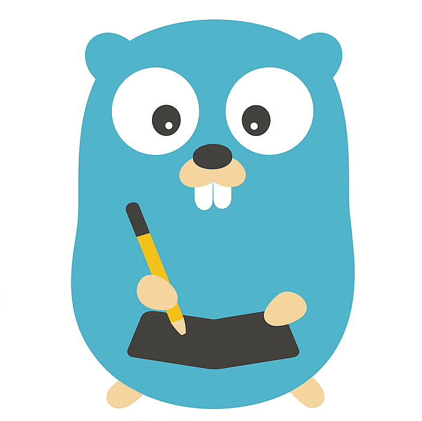
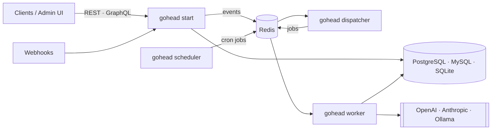

<p align="center">
  
</p>

<h1 align="center">GoHead</h1>

<p align="center">
  <strong>The headless CMS that reacts.</strong><br>
  Model content over HTTP, get REST and GraphQL instantly,<br>
  and let AI agents act on every change. One Go binary.
</p>

<p align="center">
  <a href="https://github.com/gohead-cms/gohead/actions/workflows/ci.yml"></a>
  <a href="https://github.com/gohead-cms/gohead/releases"></a>
  <a href="https://github.com/gohead-cms/gohead/pkgs/container/gohead"></a>
  <a href="https://goreportcard.com/report/github.com/gohead-cms/gohead"></a>
  <a href="https://gohead-cms.github.io/gohead/"></a>
  <a href="LICENSE.md"></a>
</p>

<p align="center">
  <a href="https://gohead-cms.github.io/gohead/getting-started/quick-start/">Quick start</a> ·
  <a href="https://gohead-cms.github.io/gohead/">Handbook</a> ·
  <a href="https://gohead-cms.github.io/gohead/agents/">Agents</a> ·
  <a href="https://gohead-cms.github.io/gohead/operations/deployment/">Deploy</a>
</p>

---

## Why GoHead?

Most headless CMSs stop at storing content. GoHead also **does something with it**: every
create, update or delete can wake up an agent that summarizes, tags, moderates, translates or
syncs, writing the result straight back into your content, with the same validation and
permissions as a human.

| | |
|---|---|
| ⚡ **Schema in, API out** | Define collections over HTTP. REST endpoints and a GraphQL schema appear immediately, no codegen, no restart. |
| 🤖 **Agents built in** | LLM agents triggered by content events, webhooks or cron, with OpenAI, Anthropic or Ollama, and typed functions to read and write content. |
| 📝 **Editorial workflow** | Draft and publish per collection, reusable (and repeatable) components, one flat JSON shape for every item. |
| 🧑‍💻 **Front-end ready** | A typed [JavaScript client](sdk/client), generated TypeScript types, content models as code, public read access, and Next.js starters ([blog](templates/nextjs-blog), [conference](templates/nextjs-conference) with a [tour of every feature](https://gohead-cms.github.io/gohead/frontend/feature-tour/)): `npm create @gohead-cms@latest`. |
| 🔌 **Integrations** | Long-lived scoped API tokens, an OpenAPI 3.1 spec with Swagger UI for typed clients, and signed outbound webhooks for Slack, Zapier or site rebuilds. |
| 🖼️ **Media built in** | Upload images, video and documents; store them on disk or in any S3-compatible bucket (S3, R2, Garage…); reference them from content. |
| 🔎 **Real querying** | Filters (`$eq $ne $lt $gte $contains`…), multi-key sort, pagination, relation population, batch writes in one transaction. |
| 🔐 **Secure by default** | Roles enforced identically in REST and GraphQL, schema-validated writes, masked secrets, signed images, distroless containers. |
| 🪶 **One binary** | API, admin UI, worker, dispatcher and scheduler in one pure-Go binary. `gohead standalone` runs it all in one process with SQLite and no Redis, in about 45 MB of memory: a Raspberry Pi is enough. PostgreSQL or MySQL and separate processes to scale out. |
| 🚢 **Ships anywhere** | Multi-arch images, a Helm chart, Kubernetes manifests and Flux image automation included. Tested on SQLite, PostgreSQL and MySQL. |

## Build a site in ten minutes

```bash
npm create @gohead-cms@latest my-site      # Next.js blog with its content model
cd my-site && docker compose up -d         # GoHead on :8080
npm run gohead:setup && npm run dev        # model, sample content, types → http://localhost:3000
```

```ts
import { createClient } from "@gohead-cms/client";

const gohead = createClient({ url: "https://cms.example.com" });
const { data } = await gohead.collection("articles").find({ sort: "publishedAt:desc", pageSize: 5, locale: "fr" });
```

See [Build a website](https://gohead-cms.github.io/gohead/frontend/).

## 60-second start

On macOS, with [Homebrew](https://brew.sh): one binary, SQLite, no Docker.

```bash
brew install gohead-cms/tap/gohead
export ADMIN_PASSWORD=$(openssl rand -hex 12)
GOHEAD_ADMIN_USERNAME=admin GOHEAD_ADMIN_EMAIL=admin@example.com \
  GOHEAD_ADMIN_PASSWORD=$ADMIN_PASSWORD gohead standalone &   # API and admin UI on :8080, data in ./data
```

Or the full stack with Docker Compose:

```bash
git clone https://github.com/gohead-cms/gohead.git && cd gohead
printf 'GOHEAD_JWT_SECRET=%s\nGOHEAD_ADMIN_USERNAME=admin\nGOHEAD_ADMIN_PASSWORD=%s\n' \
  "$(openssl rand -hex 32)" "$(openssl rand -hex 12)" > .env
docker compose up -d        # API :8080 · admin UI :3000 · Postgres · Redis · workers
export ADMIN_PASSWORD=$(sed -n 's/^GOHEAD_ADMIN_PASSWORD=//p' .env)
```

Log in as the admin (password in `$ADMIN_PASSWORD`) and model a collection:

```bash
export GOHEAD=http://localhost:8080 JSON='Content-Type: application/json'

export AUTH="Authorization: Bearer $(curl -s -X POST $GOHEAD/auth/login -H "$JSON" \
  -d "{\"username\":\"admin\",\"password\":\"$ADMIN_PASSWORD\"}" | jq -r .data.token)"

curl -s -X POST $GOHEAD/admin/collections -H "$JSON" -H "$AUTH" -d '{
  "name": "articles", "kind": "collection",
  "attributes": {
    "title":     { "type": "string", "required": true },
    "views":     { "type": "int" },
    "published": { "type": "bool" }
  }
}'
```

Write and query content:

```bash
curl -s -X POST $GOHEAD/api/collections/articles -H "$JSON" -H "$AUTH" \
  -d '[{"data":{"title":"Hello GoHead","views":42,"published":true}},
       {"data":{"title":"Filtering 101","views":250,"published":true}}]'

curl -s -G $GOHEAD/api/collections/articles -H "$AUTH" \
  --data-urlencode 'filters[views][$gte]=100' --data-urlencode 'sort=views:desc'

curl -s -X POST $GOHEAD/api/graphql -H "$JSON" -H "$AUTH" \
  -d '{"query":"{ articles(limit: 5) { id title views } }"}'
```

The full walkthrough is in the [quick start](https://gohead-cms.github.io/gohead/getting-started/quick-start/).

## Agents in one request

Summarize every new article into a `summaries` collection:

```json
POST /admin/agents
{
  "name": "summarizer",
  "system_prompt": "Summarize each new article in two sentences and store it with save_summary.",
  "max_turns": 3,
  "llm_config": { "provider": "openai", "model": "gpt-4o-mini" },
  "memory": { "type": "in-memory", "session_scope": "user" },
  "trigger": { "type": "collection_event",
               "event_trigger": { "collection": "articles", "events": ["item:created"] } },
  "functions": [{ "name": "save_summary", "impl_key": "collections.upsert_item",
                  "description": "Store a summary",
                  "parameters": { "type": "object",
                                  "properties": { "collection_name": { "type": "string" },
                                                  "data": { "type": "object" } } } }]
}
```

Triggers: **collection events**, **webhooks** (`POST /agents/webhook/{id}`) and **cron**.
Built-in functions cover content (`collections.*`) and text tasks (`llm.summarize_text`,
`llm.classify_text`, `llm.extract_structured_data`…). [Read the agents guide →](https://gohead-cms.github.io/gohead/agents/)

## How it fits together



## Install

| | |
|---|---|
| **Homebrew** (macOS) | `brew install gohead-cms/tap/gohead`, then `gohead standalone` |
| **Render** | [](https://render.com/deploy?repo=https://github.com/gohead-cms/gohead): one service and a disk, about $7 a month ([guide](https://gohead-cms.github.io/gohead/operations/render/)) |
| **Docker Compose** | `docker compose up -d` (everything, as above) |
| **Container** | `docker run -p 8080:8080 -e GOHEAD_JWT_SECRET=… ghcr.io/gohead-cms/gohead` |
| **Helm** | `helm install gohead oci://ghcr.io/gohead-cms/charts/gohead --set database.url=postgres://…` |
| **Kubernetes (GitOps)** | `kubectl apply -k deploy/kubernetes/overlays/production` (or let Flux do it) |
| **Binary** | [Releases](https://github.com/gohead-cms/gohead/releases) for Linux, macOS, Windows, Raspberry Pi: `./gohead standalone`, then open <http://localhost:8080> ([guide](https://gohead-cms.github.io/gohead/operations/standalone/)) |
| **Source** | `make ui build` (Go 1.26+, Node 22) |

Configuration is a YAML file or `GOHEAD_*` environment variables, see
[configuration](https://gohead-cms.github.io/gohead/getting-started/configuration/).

## Documentation

The **[GoHead Handbook](https://gohead-cms.github.io/gohead/)** covers everything:

- [User manual](https://gohead-cms.github.io/gohead/manual/): the admin UI step by step, with screenshots
- [Build a website](https://gohead-cms.github.io/gohead/frontend/) · [JavaScript client](https://gohead-cms.github.io/gohead/frontend/sdk/) · [Content models as code](https://gohead-cms.github.io/gohead/frontend/model-as-code/) · [Next.js starter](https://gohead-cms.github.io/gohead/frontend/nextjs/)
- [Content modeling](https://gohead-cms.github.io/gohead/guides/content-modeling/) · [REST API](https://gohead-cms.github.io/gohead/guides/rest-api/) · [GraphQL](https://gohead-cms.github.io/gohead/guides/graphql/) · [Users & roles](https://gohead-cms.github.io/gohead/guides/users-and-roles/)
- [Agents](https://gohead-cms.github.io/gohead/agents/) · [Triggers](https://gohead-cms.github.io/gohead/agents/triggers/) · [Functions](https://gohead-cms.github.io/gohead/agents/functions/) · [LLM providers](https://gohead-cms.github.io/gohead/agents/llm-providers/)
- [Deployment](https://gohead-cms.github.io/gohead/operations/deployment/) · [CI/CD & releases](https://gohead-cms.github.io/gohead/operations/ci-cd/) · [Security](https://gohead-cms.github.io/gohead/operations/security/) · [Troubleshooting](https://gohead-cms.github.io/gohead/operations/troubleshooting/)

## Status

GoHead is **pre-1.0**: the API is usable and tested, and may still change between minor
versions (see the [changelog](CHANGELOG.md)). Known gap: dynamic zones.

## Contributing

Issues and pull requests are welcome. Start with the
[contributing guide](https://gohead-cms.github.io/gohead/development/contributing/):

```bash
make test-race   # Go tests
make up          # full stack from your checkout
make docs        # handbook on :8000
```

## License

[MIT](LICENSE.md)
