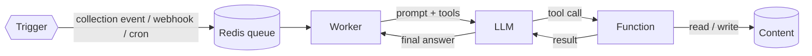

# Agents

An **agent** is an LLM with a system prompt, a set of **functions** it may call, and a
**trigger** that decides when it runs. Agents turn GoHead from a content store into an
automation engine: summarize every new article, tag products, triage incoming webhooks,
publish a nightly digest.



## Requirements

Agents run outside the API, in three background processes that share the API's
configuration and its job queue (Redis, or the database):

| Process | Command | Role | Replicas |
|---------|---------|------|----------|
| Dispatcher | `gohead dispatcher` | Turns content events into agent jobs | 1+ |
| Worker | `gohead worker` | Runs agent jobs (LLM calls, functions) | 1+ |
| Scheduler | `gohead scheduler` | Enqueues cron-triggered runs | **exactly 1** |

Docker Compose and the Kubernetes manifests start all three. `gohead standalone` runs all
three inside the API process, with no Redis (see [Standalone](../operations/standalone.md)).

## A complete example

Store a summary of every new article in a `summaries` collection:

```bash
curl -X POST $GOHEAD/admin/collections -H "$JSON" -H "$AUTH" -d '{
  "name": "summaries", "kind": "collection",
  "attributes": { "text": { "type": "text", "required": true }, "source": { "type": "string" } }
}'

curl -X POST $GOHEAD/admin/agents -H "$JSON" -H "$AUTH" -d '{
  "name": "summarizer",
  "system_prompt": "When an article is created, write a two-sentence summary and store it with save_summary in the summaries collection.",
  "max_turns": 3,
  "llm_config": { "provider": "openai", "model": "gpt-4o-mini" },
  "memory": { "type": "in-memory", "session_scope": "user" },
  "trigger": {
    "type": "collection_event",
    "event_trigger": { "collection": "articles", "events": ["item:created"] }
  },
  "functions": [{
    "name": "save_summary",
    "description": "Store a summary item",
    "impl_key": "collections.upsert_item",
    "parameters": {
      "type": "object",
      "properties": {
        "collection_name": { "type": "string" },
        "data": { "type": "object" }
      },
      "required": ["collection_name", "data"]
    }
  }]
}'
```

Create an article and, a moment later, the summary appears in `summaries`.

## Agent fields

| Field | Required | Description |
|-------|----------|-------------|
| `name` | yes | Unique name. |
| `system_prompt` | yes | Instructions. Be explicit about which function to call and when. |
| `max_turns` | yes | Maximum LLM round-trips per run (each tool call uses one). |
| `llm_config` | yes | `provider` (required), `model`, `api_key`, `base_url`, and optional `input_cost_per_million` / `output_cost_per_million` (USD) to track cost. See [LLM providers](llm-providers.md). |
| `memory` | yes | `type` and `session_scope` (e.g. `in-memory` / `user`). |
| `trigger` | yes | See [Triggers](triggers.md). |
| `functions` | no | Tools the LLM may call, optionally limited to some collections. See [Functions](functions.md). |
| `limits` | no | Rate, token and cost limits. See [Runs and limits](runs-and-limits.md#limits). |

## How a run works

1. The trigger produces a job with a contextual first message (the event's item data, the
   webhook payload, or the scheduled time).
2. The worker sends the system prompt, recent history and that message to the LLM, along with
   the agent's functions as tools.
3. Each tool call is executed and its JSON result returned to the LLM, until the LLM answers
   with plain text or `max_turns` is reached.
4. The conversation is saved. The last 40 messages are replayed on the next run so the agent
   keeps context without growing forever.
5. Every step is recorded as it happens: the trigger, each model call and function call with
   its arguments, result, tokens and duration, and how the run ended. See
   [Runs and limits](runs-and-limits.md).

## Managing agents

| Method | Path |
|--------|------|
| `GET` | `/admin/agents` |
| `POST` | `/admin/agents` |
| `GET` / `PUT` / `DELETE` | `/admin/agents/{name}` |
| `GET` | `/admin/agents/{name}/runs` |
| `GET` | `/admin/agents/{name}/runs/{id}` |
| `GET` | `/admin/agents/{name}/usage` |

Responses mask `llm_config.api_key`, `api_secret` and `trigger.webhook_token` as
`********`. Sending the mask back in a `PUT` keeps the stored value.

## Tips

- Agents write through the same validation as the API: give them exact collection and field
  names in the system prompt, or let them call `collections.get_schema` first.
- Writes made by agents do not emit events, so an agent can safely update the item that
  triggered it.
- Start with a small `max_turns` (3–5) and a cheap model, then tune.
- Set [`limits`](runs-and-limits.md#limits) on event-driven agents before pointing them at a
  busy collection.
- Scope `collections.*` functions to the collections the agent needs.
