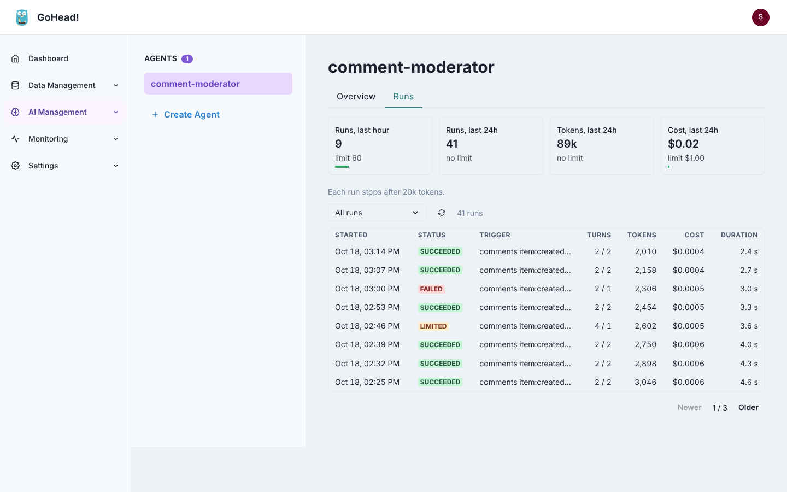

# Runs and limits

Every time an agent runs, the worker records what started it, every model call and
function call it made, what they returned, the tokens and cost they used, and how the run
ended. Limits stop an agent before it runs too often or spends too much.

## Run history

Open an agent in the admin UI and choose the **Runs** tab: usage over the last hour and day
against the agent's limits, then its runs, newest first. Click a run to see it step by step.

{ loading=lazy }

A run records:

| Field | Description |
|-------|-------------|
| `status` | `running`, `succeeded`, `failed` or `limited` |
| `triggerType`, `trigger` | `collection_event`, `webhook`, `schedule` or `manual`, and the trigger payload (JSON) |
| `input` | The first message sent to the model |
| `output` | The model's final answer |
| `error` | Why the run failed or was limited, or a note such as `stopped after max_turns (3) without a final answer` |
| `attempt` | `1`, or more when the queue retried a failed run |
| `turns`, `toolCalls` | Model calls and function calls made |
| `provider`, `model` | The model used |
| `inputTokens`, `outputTokens`, `costUsd` | Usage, including calls made by `llm.*` helper functions |
| `startedAt`, `finishedAt`, `durationMs` | Timing (UTC) |

Each **step** is one model call (`type: llm`, with its text or the functions it asked for) or
one function call (`type: tool`, with its arguments, JSON result, `implKey` and duration).
A function that returns `{"status": "error", …}`, such as a call refused by a
[collection scope](functions.md#limiting-functions-to-collections), is shown as a failed step.

Runs are saved as they progress, so a long run can be followed while it is still `running`.
A run whose worker was killed stays `running`; the queue retries the job as a new run.

Texts longer than 16 KB (payloads, arguments, results) are truncated. The newest 200 runs of
each agent are kept; change it with [`agents.runs_kept`](../getting-started/configuration.md#llm-defaults).
Runs in progress are never pruned. Deleting an agent deletes its runs and its conversation
history.

### API

```bash
# Newest runs; filter with status=succeeded|failed|limited|running
curl "$GOHEAD/admin/agents/summarizer/runs?status=failed&page=1&pageSize=20" -H "$AUTH"

# One run with its steps
curl $GOHEAD/admin/agents/summarizer/runs/42 -H "$AUTH"

# Usage over the last hour and 24 hours, next to the limits
curl $GOHEAD/admin/agents/summarizer/usage -H "$AUTH"
```

```json
{
  "data": {
    "lastHour": { "runs": 12, "inputTokens": 18400, "outputTokens": 2100, "costUsd": 0.004 },
    "lastDay":  { "runs": 140, "inputTokens": 212000, "outputTokens": 25300, "costUsd": 0.047 },
    "limits": { "max_runs_per_hour": 60, "max_cost_per_day": 1 },
    "costKnown": true
  }
}
```

## Limits

Add `limits` to an agent. Every limit is optional; `0` or absent means no limit.

```json
"limits": {
  "max_runs_per_hour": 60,
  "max_runs_per_day": 500,
  "max_tokens_per_run": 20000,
  "max_tokens_per_day": 1000000,
  "max_cost_per_day": 2.5
}
```

| Limit | Checked | Effect |
|-------|---------|--------|
| `max_runs_per_hour` | before a run | The run is skipped |
| `max_runs_per_day` | before a run | The run is skipped |
| `max_tokens_per_run` | after every model and function call | The run stops |
| `max_tokens_per_day` | before a run, and after every call | The run is skipped or stops |
| `max_cost_per_day` | before a run, and after every call | The run is skipped or stops |

- Windows are rolling: "per hour" means the last 60 minutes, "per day" the last 24 hours.
- A skipped or stopped run is recorded with status `limited` and the reason in `error`, and
  is **not retried**. Skipped runs don't count toward the run limits; tokens and cost spent
  before a run was stopped do count.
- A limit stops a run between steps, before the next function call, so a run can go over by
  the size of one call. A run whose model has given its final answer completes normally
  even if that answer crossed a limit; the next run is refused. Keep `max_turns` small to
  bound the overshoot.
- Limits are per agent and counted from the run history in the database, so they hold
  across any number of workers. Runs starting at the same time are counted in the order
  they were created, and runs still in progress count, so a burst of events cannot slip
  past `max_runs_per_hour`. Daily token and cost limits include what runs in progress on
  other workers have spent so far.
- If usage cannot be read from the database, the run does not start (and is retried).

### Costs

GoHead has no built-in price list. To track cost, set the model's prices in USD per million
tokens:

```json
"llm_config": {
  "provider": "openai",
  "model": "gpt-4o-mini",
  "input_cost_per_million": 0.15,
  "output_cost_per_million": 0.60
}
```

An agent on the instance's default provider and model inherits the
[default prices](llm-providers.md#instance-defaults). `max_cost_per_day` needs prices in the
agent's own `llm_config`, so that a limit never silently counts $0.

Token counts come from the provider's response (OpenAI and compatible APIs, Anthropic,
Ollama). Calls made by `llm.*` helper functions use the instance's default model and prices,
and count toward the run that made them.

## Debugging an agent

1. Open the **Runs** tab and filter on **Failed** or **Limited**.
2. Open the run: the trigger shows exactly what the agent received, and each step what the
   model asked for and what came back.
3. Typical findings: the model calls a function with a wrong `collection_name` or field
   (fix the system prompt, or have it call `collections.get_schema` first); a function is
   refused by its scope; the run hits `max_turns` because the model never gives a final
   answer.
