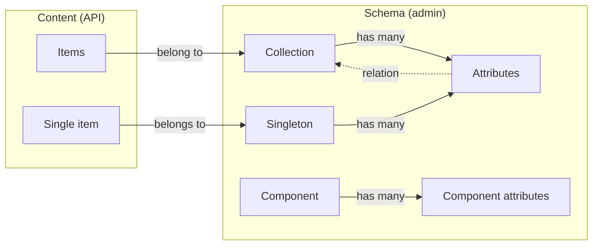
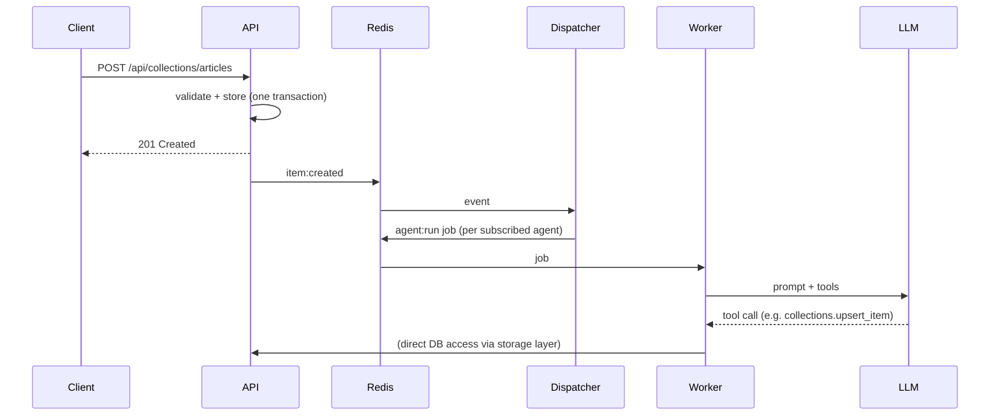

# Concepts

## Content model

| Concept | What it is | Example | Managed at |
|---------|-----------|---------|------------|
| **Collection** | A content type with many items. | `articles`, `products` | `/admin/collections` |
| **Attribute** | A typed field of a collection or singleton, with validation rules. | `title: string, required` | inside the schema |
| **Item** | One entry of a collection, stored as validated JSON. | an article | `/api/collections/{name}` |
| **Singleton** | A content type with exactly one item. | `homepage`, `settings` | `/admin/singleton` |
| **Component** | A reusable group of attributes. | `seo` (meta title, description) | `/admin/components` |
| **Relation** | An attribute pointing to items of another collection. | article → author | inside the schema |

Schema changes take effect immediately: REST routes are dynamic and the GraphQL schema is
rebuilt whenever a collection is created, updated or deleted.

## Access

Every API call except registration, login, health and webhooks needs a bearer token.
Tokens carry a role: **admin** (everything), **editor** (all content operations) or
**viewer** (read-only). The same rules apply to REST and GraphQL.
See [Users & roles](users-and-roles.md).

## Events and agents

Every item create, update or delete emits an event on a Redis queue. The **dispatcher**
matches events to subscribed **agents** and enqueues jobs; the **worker** runs them by
talking to an LLM that can call **functions** to read or write content. Agents can also be
started by a cron **schedule** or an authenticated **webhook**.

Read more in [Agents](../agents/index.md) and [Architecture](../operations/architecture.md).
