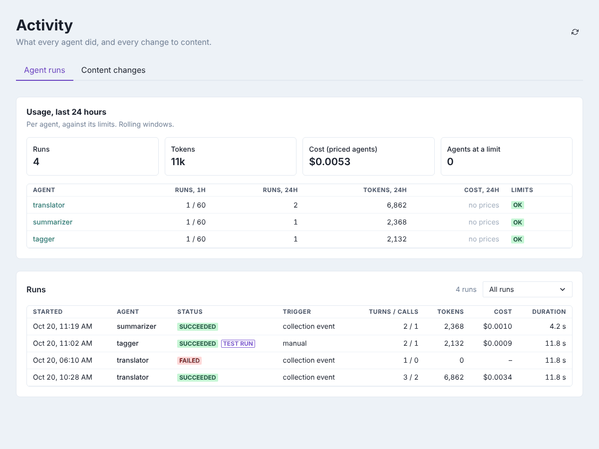
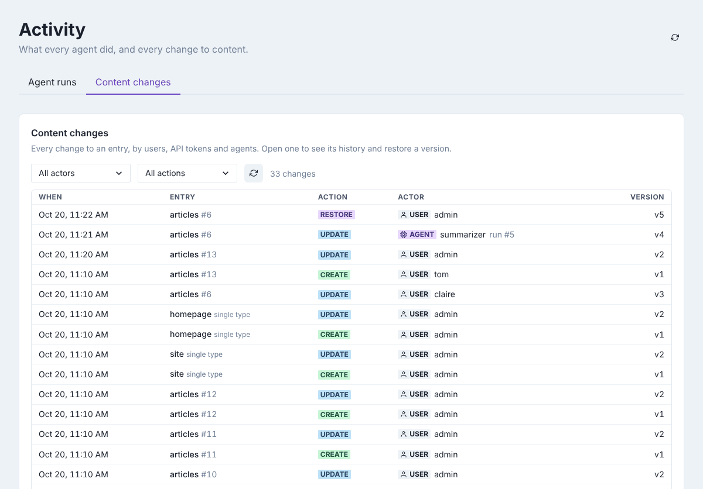
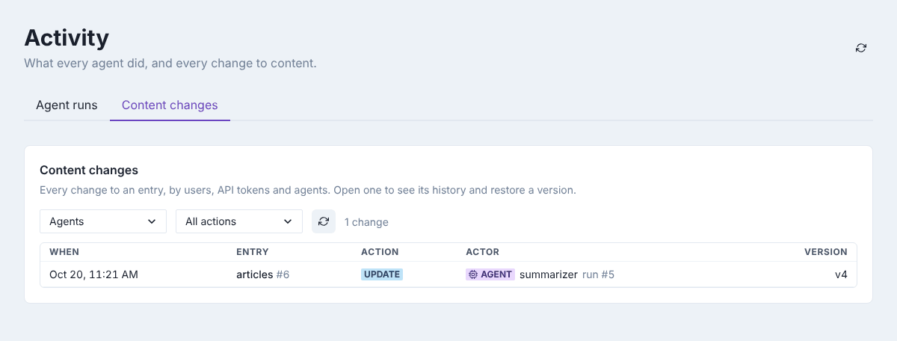
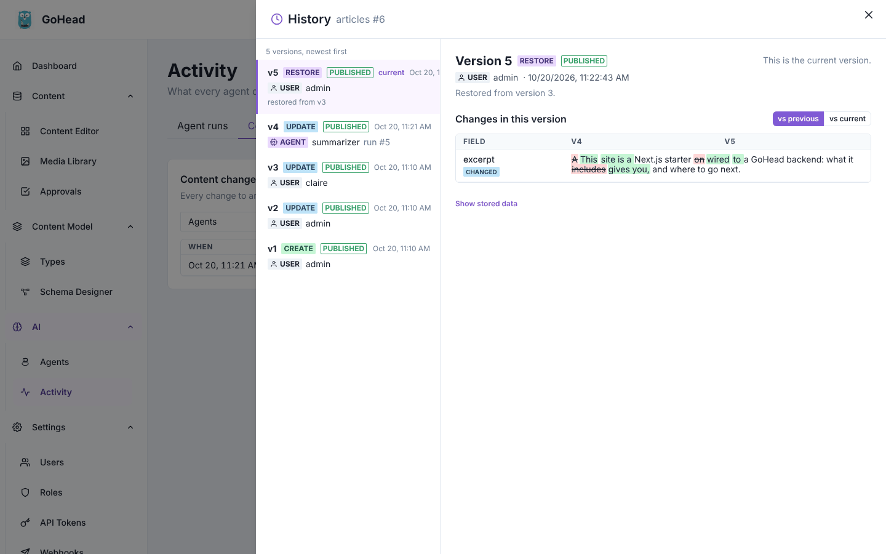

# Activity

The **Activity** page answers two questions: what have the agents been doing, and who
changed what in the content? It gathers the runs of every agent, their usage against their
limits, and every content change made by people, API tokens and agents. Only admins can open
it, under **AI → Activity**.

## Agent runs

The **Agent runs** tab opens first.

**Usage, last 24 hours** sums up the runs, the tokens and the cost of every agent, and how
many agents have reached one of their limits. The table below gives, per agent, the runs
in the last hour and the last 24 hours (with the limit, if one is set), the tokens and the
cost. The **Limits** column reads **ok**, a percentage when an agent is close to a limit
(80% or more), **at limit** when it has reached one, or **no limits**. Costs show
**no prices** for agents without input and output prices. Click an agent's name to open
it.

**Runs** lists the runs of all agents, newest first, with the same columns as an agent's
Runs tab plus the agent's name. Choose a status in the list on the right (**Succeeded**,
**Failed**, **Limited**, **Running**, **Queued**) to see only those, for example to find
failed runs. Click a run to see its steps, what it proposed and what it changed, and to
[revert it](agents.md#undo-what-a-run-changed).

The usage numbers are rolling windows: "last hour" means the last 60 minutes. Click the
refresh button at the top right to update the page.

## Content changes

The **Content changes** tab lists every change to an entry or a single type, newest first:
when, which entry, the action, who did it, and the version it created. The actor is a
**user**, an API **token**, an **agent** (with the run that made the change) or the
**system**.

Narrow the list with the two filters:

- **All actors**: only changes by **Users**, **API tokens**, **Agents** or the **System**.
- **All actions**: only **Created**, **Updated**, **Published**, **Unpublished**,
  **Deleted** or **Restored** changes, or **Before history (baseline)**, the versions
  recorded for entries that existed before history was turned on.

Click a change to open the entry's history: every version, who made it, what changed, and a
way to restore an older one (see
[Compare versions and restore one](editing-content.md#compare-versions-and-restore-one) for how to compare and restore versions).

More about history and the change feed: [Content history](../guides/content-history.md).
To keep an eye on costs, also see [Runs and limits](../agents/runs-and-limits.md).
