# Agents

An agent is an AI assistant that works on your content by itself: it summarizes new
articles, picks tags, flags spam or translates entries into other languages. Each agent is a
language model with instructions (its *system prompt*), the functions it may call to read
and write content, and a trigger that starts it, such as "an article was created". Only
admins create and manage agents, under **AI → Agents**; editors review the changes of agents
that need approval on the [Approvals](approvals.md) page.

!!! note "Before you start"
    Agents need an LLM provider (OpenAI, Anthropic or a local Ollama) and GoHead's
    background workers, which run with Redis. Ask whoever runs GoHead if they are set up:
    see [Agents → Requirements](../agents/index.md#requirements).

## The agents page

The list of agents is on the left. Click one to open it. Its **Overview** tab shows what it
does: the system prompt, the model, the trigger, whether it needs approval, its limits and
its functions, with the collections each function may touch.

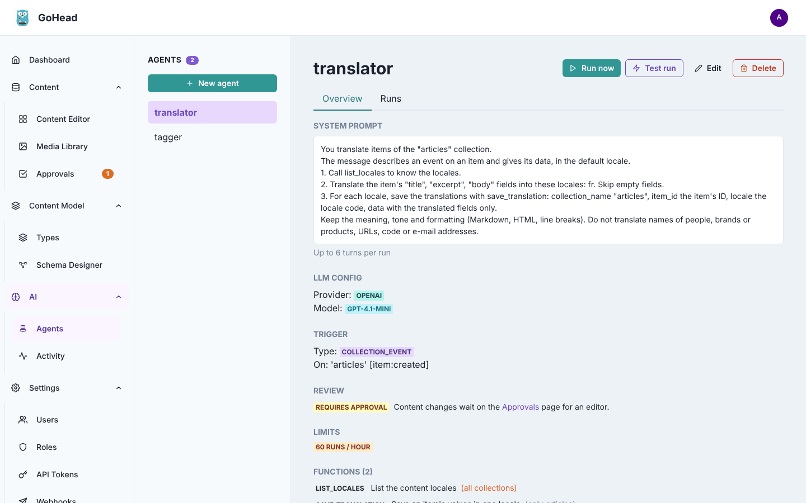

The buttons at the top run the agent ([Run now](#run-an-agent-now)), try it without
changing anything ([Test run](#try-an-agent-with-a-test-run)), **Edit** it or **Delete** it.
Deleting an agent also deletes its run history.

## Create an agent from a template

Templates write the system prompt, trigger and functions for common tasks: **Summarizer**,
**Tagger**, **Moderator** and **Translator**. You answer a few questions and review the
result before anything is saved.

1. Click **New agent**.
2. Choose a template and click **Use template**.

    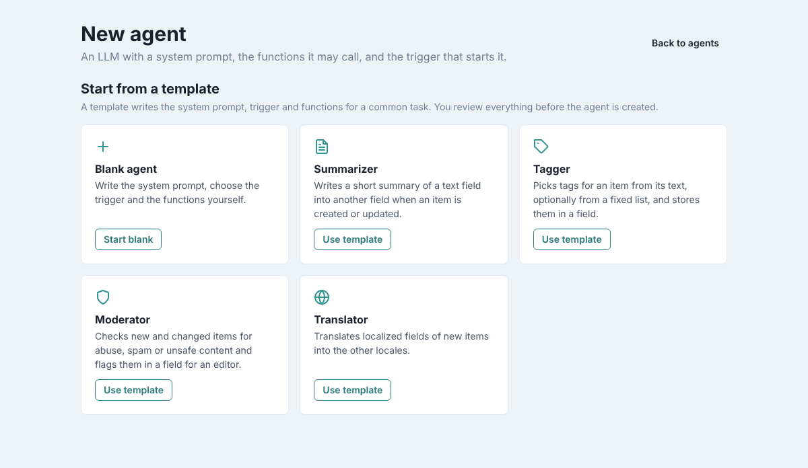

3. Answer the template's questions. For the Summarizer: the **Collection**, the **Text to
   summarize**, the **Field for the summary** and the **Maximum words**. Turn on
   **Changes need an editor's approval** to review each change before it is saved. Give the
   agent a name, or leave **Agent name** empty for one like `summarizer-articles`.
4. Click **Continue**.

    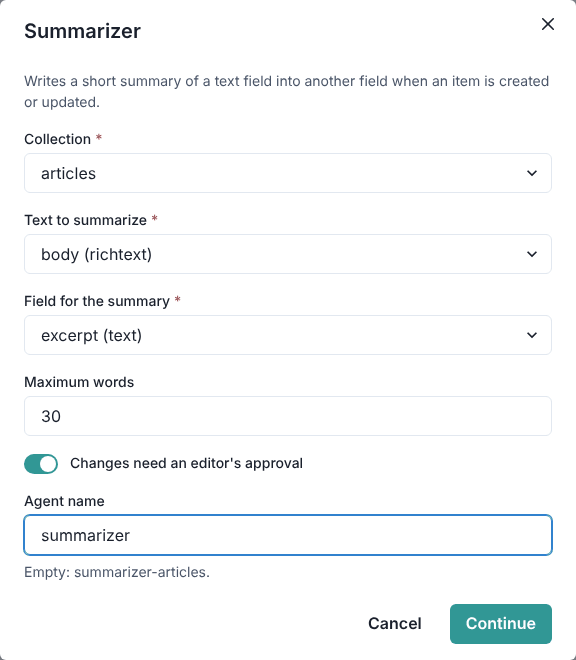

5. Review the prepared agent. The banner says which template it comes from; **Choose
   another template** starts again. Check in particular:
    - the **System prompt**, which you can adapt (keep the function, collection and field
      names exact);
    - the **Model** section: leave it empty to use your instance's default model, or set
      another one. Fill in the **Input price** and **Output price** if you want costs and a
      cost limit;
    - the **Limits**: templates start at 60 runs per hour.
6. Click **Create agent** at the bottom. The agent's page opens; it starts working on the next
   matching event.

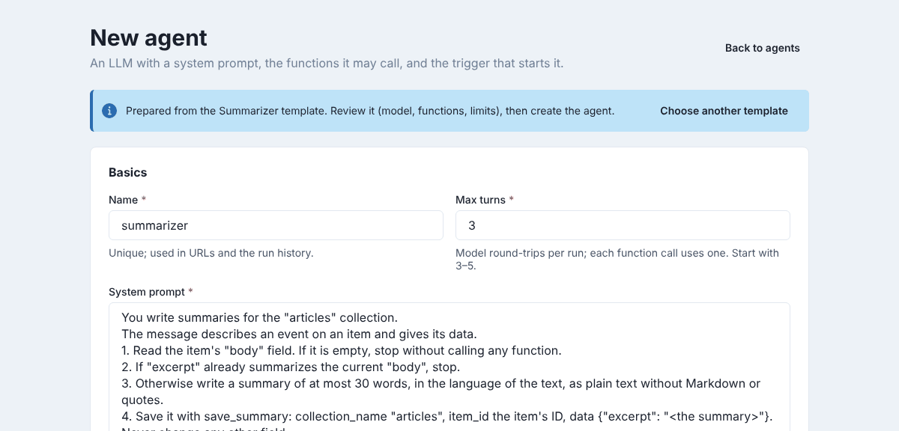

Each template and its options: [Templates](../agents/templates.md).

## Create an agent from scratch

Choose **Start blank** in the gallery, then fill in each section of the form:

- **Basics**: a unique **Name**, the **Max turns** (how many model calls a run may make; 3 to
  5 is usual) and the **System prompt**. Be explicit: say which function to call, when, and
  with which collection and field names.
- **Model**: the **Provider**, the **Model** and, if this agent has its own, an **API key**.
  Empty fields use the instance defaults.
- **Trigger**: what starts a run. **Collection event** runs on events of one collection
  (**Created**, **Updated**…; writes made by agents trigger nothing). **Schedule (cron)** runs
  at fixed times, in UTC. **Webhook** gives a URL another service can call. **Manual** only
  runs from the admin UI.

    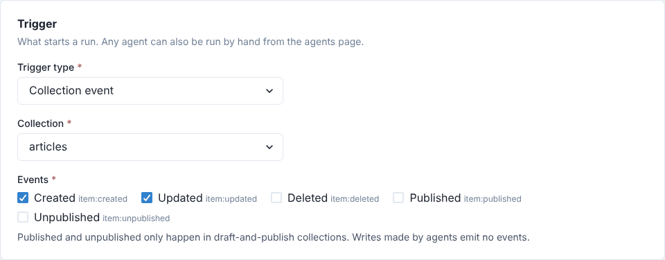

- **Functions**: click **Add function** and pick an **Implementation** (for example
  `collections.patch_item` to change fields of an entry); its description and parameters are
  filled in. Give it the **Function name** the system prompt uses. For functions that read or
  write content, check the **Allowed collections**: with none checked, the function may use
  every collection, which is rarely what you want for writes.

    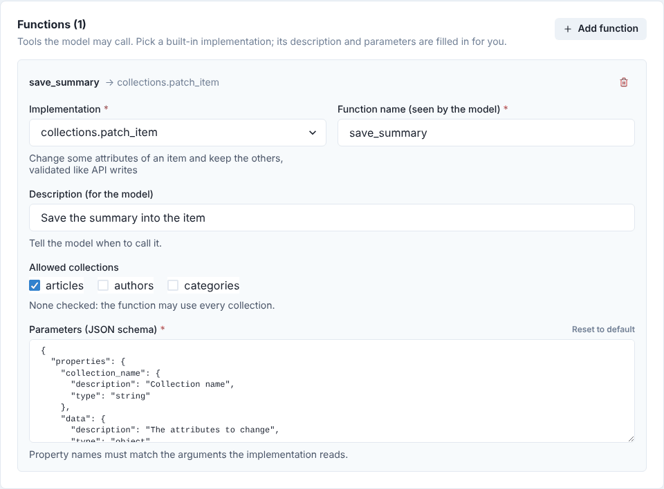

- **Review**: turn on **Require approval** to have every create, update, translation and
  delete wait on the [Approvals](approvals.md) page instead of being applied.

    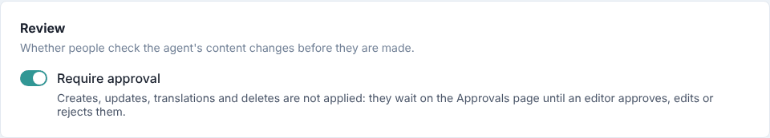

- **Limits**: maximum runs per hour and per day, tokens per run and per day, and cost per
  day. Empty means no limit: set at least **Max runs per hour**. A run over a limit is
  skipped or stopped and shown as **limited**.
- **Memory**: the defaults suit most agents.

Click **Create agent**. If a field is wrong, the form says which ones to fix. Every field is
explained in [Agent fields](../agents/index.md#agent-fields) and
[Functions](../agents/functions.md).

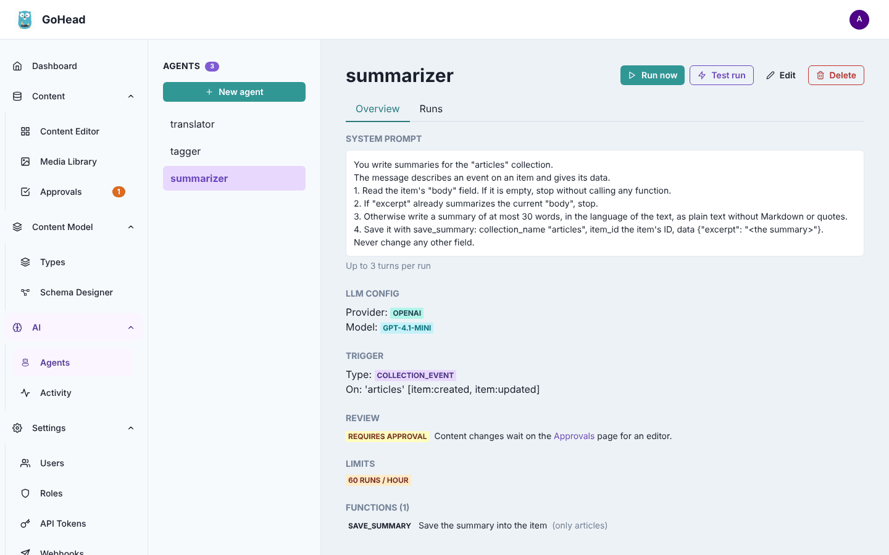

## Follow its runs

Each time the agent works, it records a **run**. Open the **Runs** tab to see the agent's
usage over the last hour and 24 hours against its limits, then its runs, newest first: when
it started, its status (**succeeded**, **failed**, **limited**, **running** or **queued**),
what triggered it, the number of model and function calls, the tokens, the cost and the
duration. Filter them by status with the list above the table.

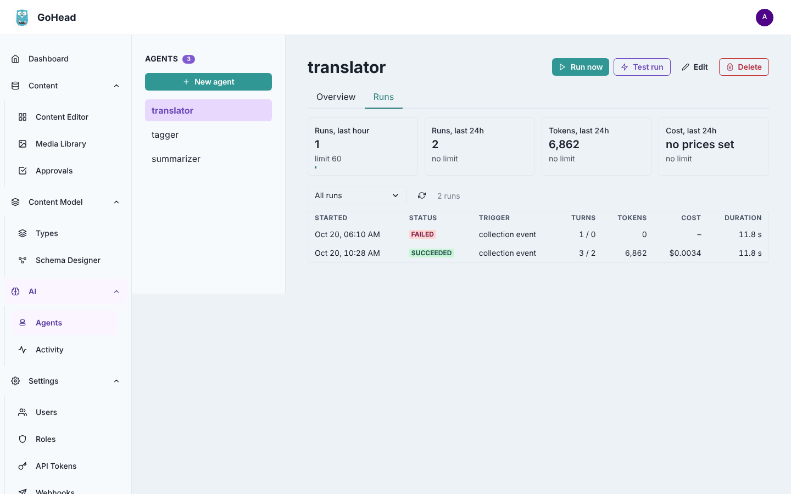

Click a run to see what it did, step by step: each **model** call with its tokens, and each
**function** call with the arguments the model chose and the result it got. A failed run
shows its error at the top.

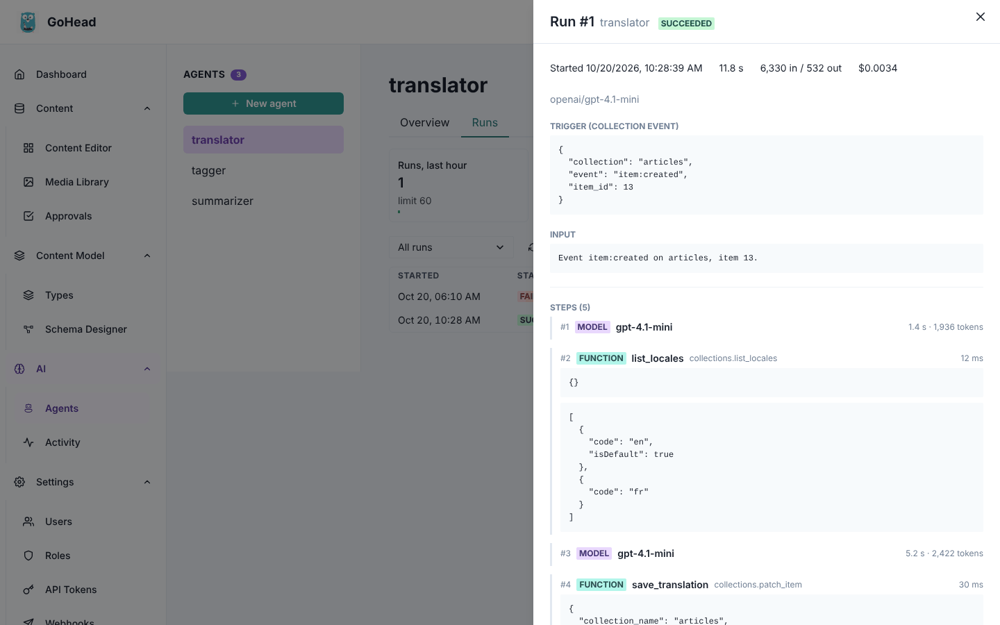

At the bottom, a run lists the changes it **proposed** (agents that need approval, with a
**Review in Approvals** button) and the **content changes** it made.

## Try an agent with a test run

A test run lets you check an agent before trusting it with real content. It calls the model
and reads content as usual, but its creates, updates and deletes are only reported ("would
update…"): nothing is written and nothing is sent for approval.

1. On the agent's page, click **Test run**.
2. For an agent triggered by collection events, choose **On an entry of …**, then pick the
   **Entry** and the **Event** to simulate. Otherwise, or with **With a message**, type the
   message the agent receives.
3. Click **Start test run**.

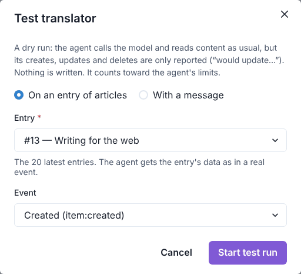

The Runs tab opens with the new run, which fills in as it goes. Test runs are marked
**test run**, and their function results say `"dry_run": true` and what they would have
done:

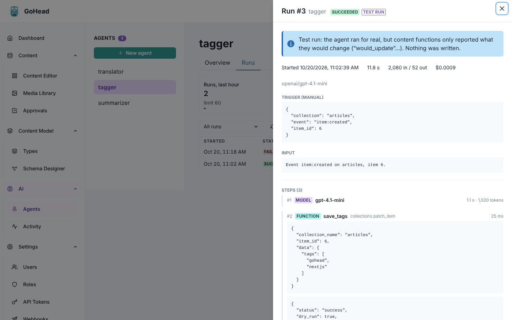

Test runs cost tokens and count toward the agent's limits like any run. More details:
[Test runs](../agents/runs-and-limits.md#test-runs).

## Run an agent now

To start an agent outside its trigger (to catch up after a change of prompt, or for an agent
with a manual trigger):

1. Click **Run now**.
2. Optionally, type an **Input**: the first message the agent receives. Empty, it is told
   to do its task.
3. Click **Queue run**.

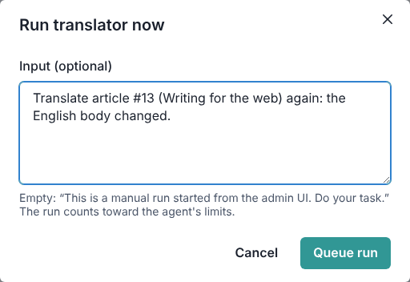

The Runs tab opens on the new run: **queued** until a worker picks it up, then **running**,
then finished. Unlike a test run, a run started this way really changes content (or
proposes the changes, for an agent that needs approval).

!!! warning "Could not queue the run"
    If the dialog answers that the job queue (Redis) is unreachable, GoHead's background
    workers are not running: neither **Run now**, **Test run** nor triggers can start agents.
    Ask whoever runs GoHead.

## Undo what a run changed

If an agent got it wrong, you can undo all the content changes of one of its runs at once.

1. Open the run (from the Runs tab or the [Activity](activity.md) page). Its **Content
   changes** list the entries it changed.

    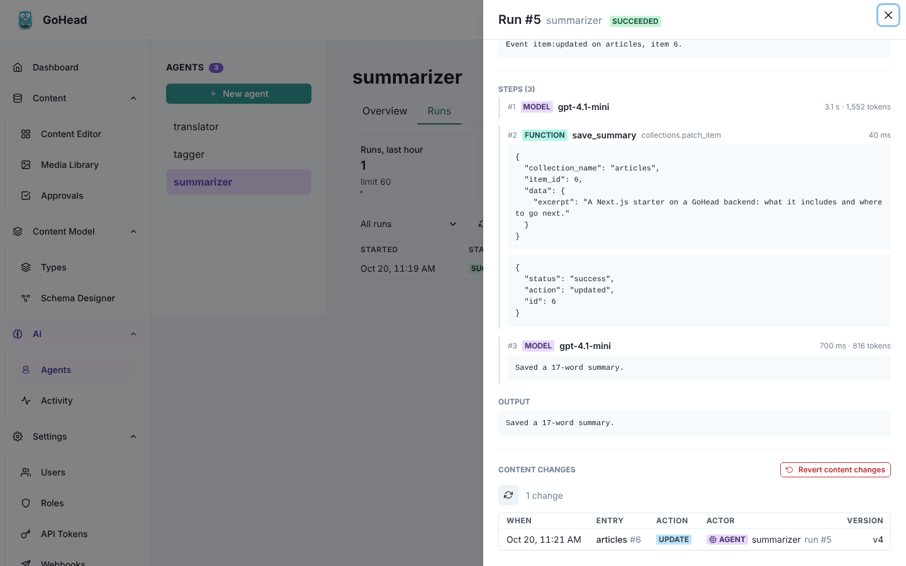

2. Click **Revert content changes**.
3. Read the confirmation. Entries someone changed after the run are skipped, so their work
   is not lost; check **Also revert entries changed by someone after the run** to revert them
   anyway.
4. Click **Revert**.

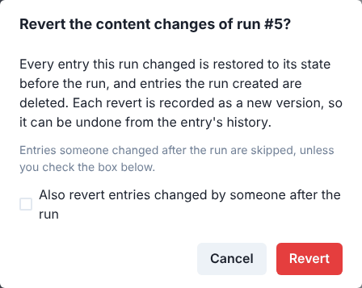

Every entry the run changed goes back to its version from before the run, and entries the
run created are deleted. The **Revert result** says what happened to each entry:
**reverted**, **deleted**, **skipped** (with the reason) or **failed**.

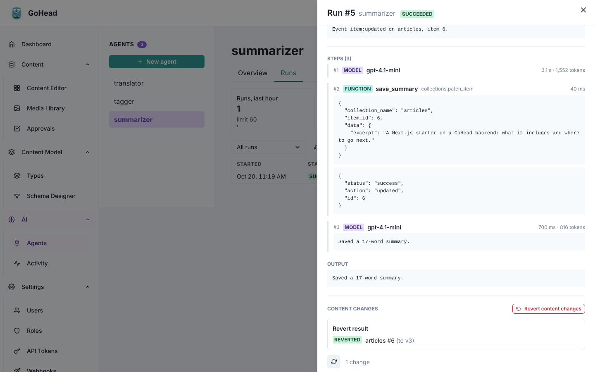

Each revert is saved as a new version in the entry's history, under your name, so it can be
undone too. See [Reverting an agent run](../guides/content-history.md#reverting-an-agent-run).
