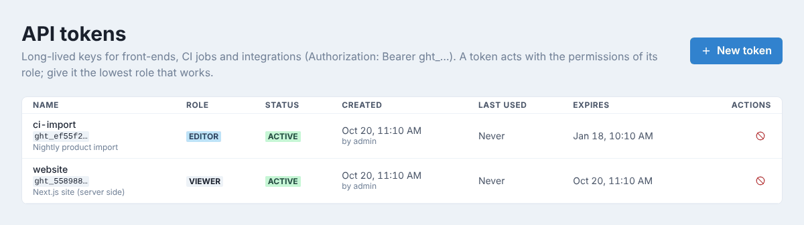
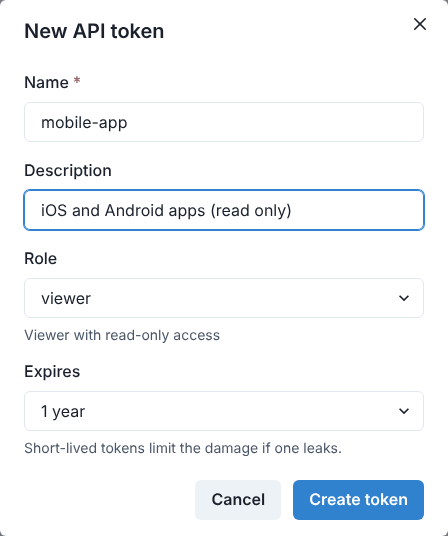
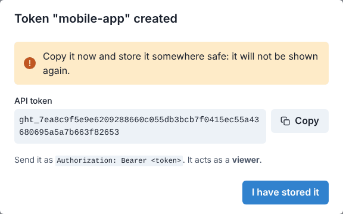
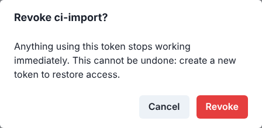
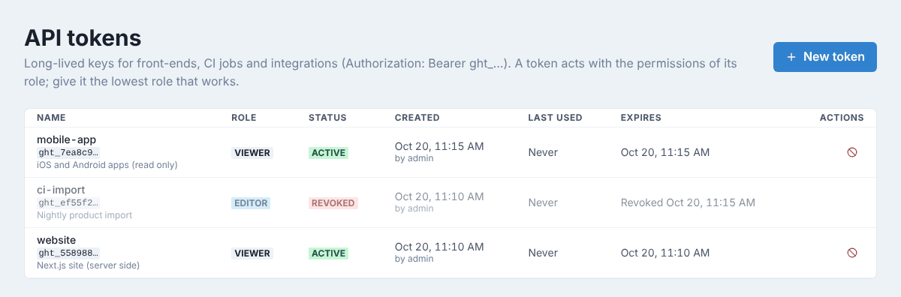

# API tokens

An API token lets a program (a website, a mobile app, a CI job, an import script) use the
GoHead API without a person's login. Each token has a role, so it can do exactly what that
role allows and nothing more. Only admins manage tokens, under **Settings → API Tokens**.

The page lists every token with its role, its status (**active**, **expired** or
**revoked**), who created it, when it was last used and when it expires. Under each name,
the first characters of the token (`ght_…`) help you recognize it in a configuration file.



## Create a token

1. Click **New token**.
2. Give it a **Name** that says what uses it (`website`, `mobile-app`, `ci-deploy`…) and,
   optionally, a **Description** (what uses it, who to ask).
3. Pick the **Role**: built-in or custom. Choose the lowest role that works: **viewer** for
   a website that only reads published content, **editor** for a script that writes content.
4. Pick when it **Expires**: **30 days**, **90 days**, **1 year**, **Never**, or **Custom…**
   for a number of days (up to 3650).
5. Click **Create token**.



## Copy it now: it is shown once

The next dialog shows the token. Click **Copy**, store it where the program reads its
secrets (an environment variable, a secrets manager), then click **I have stored it**.



!!! warning
    GoHead keeps only a fingerprint of the token: it cannot show it again. If you lose it,
    revoke it and create a new one.

## Use it

Send the token in the `Authorization` header of every request:

```bash
curl https://cms.example.com/api/collections/articles \
  -H "Authorization: Bearer ght_7ea8c9f5e9e6…"
```

It works for the REST and GraphQL APIs and for uploads. The **Last used** column shows
when the token was last used, so you can spot tokens nothing uses any more. Changes made
with a token appear in the content history as `token:<name>`.

## Revoke a token

Revoke a token when it may have leaked, or when what used it is gone.

1. Click the red icon at the end of the token's row.
2. Confirm with **Revoke**.



The token stops working immediately. It stays in the list, greyed out and marked
**revoked**, so you keep a record of it; it cannot be reactivated.



For the API behind this page and more examples, see
[API tokens](../guides/integrations.md#api-tokens).
