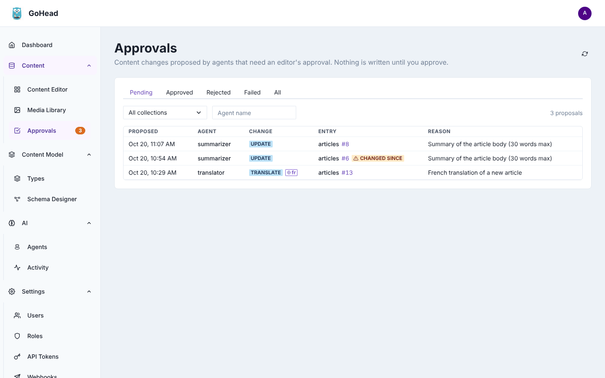
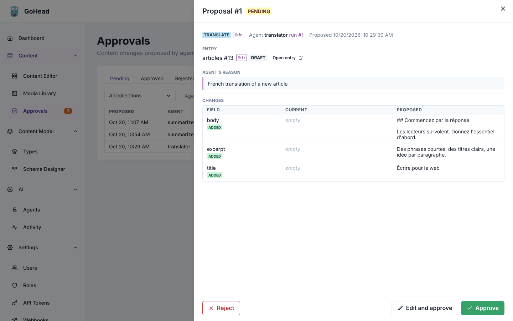
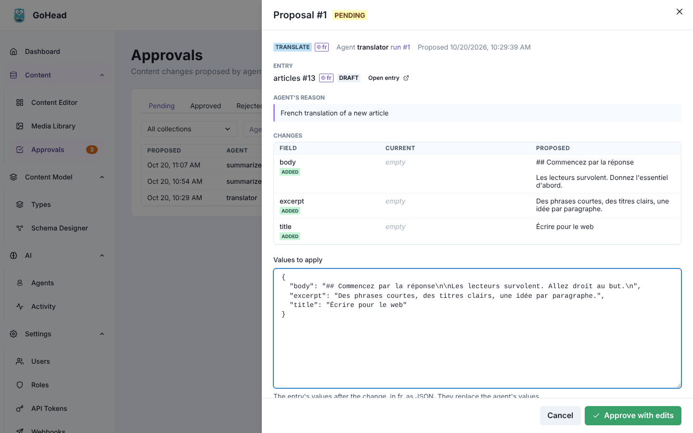
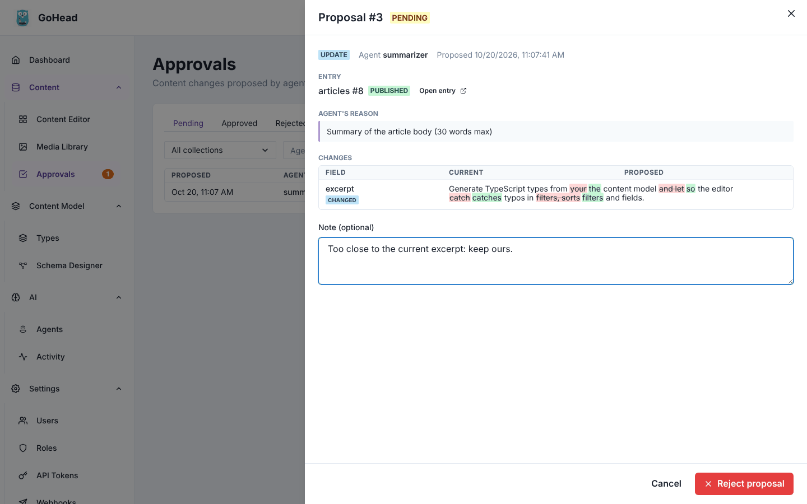
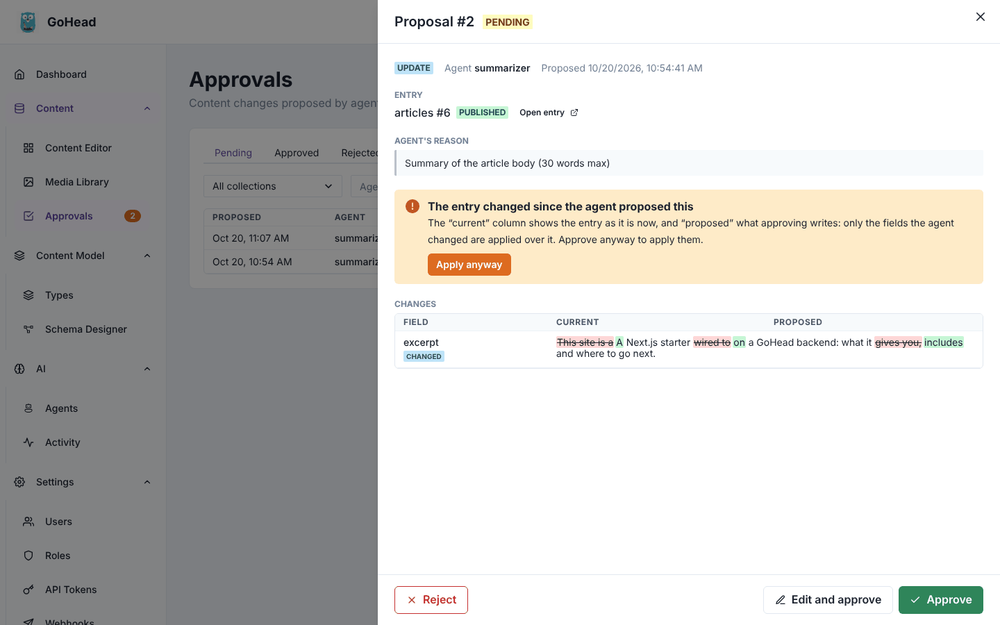
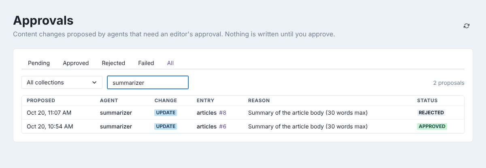

# Approvals

Agents with **Require approval** turned on do not change content themselves: they propose
each change, and a person approves, corrects or rejects it on the **Approvals** page. Anyone
whose role can make the change may review it (editors, admins, and custom roles that can
create, update or delete), and each reviewer only sees the proposals they could apply.

## Find what is waiting

Open **Content → Approvals**. The orange badge next to it in the sidebar counts the
proposals waiting for you.

The **Pending** tab lists them, newest first: when the agent proposed the change, which
agent, the kind of change (**update**, **create**, **delete**, or **translate** with the
locale), the entry, and the agent's reason. **changed since** warns that the entry was
modified after the agent proposed the change (see
[Stale proposals](#when-the-entry-changed-since)).

## Review a proposal

Click a row to open the proposal. It shows the agent and the run that proposed it (admins
can click the run to see what the agent did), the entry with its status and an **Open
entry** button, the agent's reason, and the **Changes**: each field, its **Current** value and
the **Proposed** one. Long texts are shown as one text with removed words struck out and
added words highlighted.

Then choose one of the three buttons at the bottom.

### Approve

Click **Approve**. The change is saved as the agent, in its run: the entry's history shows
the agent, and [reverting the run](agents.md#undo-what-a-run-changed) undoes it.

### Edit and approve

When the change is almost right:

1. Click **Edit and approve**.
2. Correct the values in **Values to apply**. They are the entry's values after the change,
   as JSON (in the proposal's locale for a translation): keep the quotes and commas.
3. Click **Approve with edits**, or **Cancel** to go back.

A change you edited is yours: the history shows you, not the agent.

### Reject

1. Click **Reject**.
2. Optionally, write a **Note** saying why.
3. Click **Reject proposal**.

Nothing is changed. The note is kept with the proposal, on the **Rejected** tab.

## When the entry changed since

If someone edited the entry (or another proposal was applied) after the agent proposed its
change, the proposal is *stale*. It opens with a warning, and the **Current** column shows
the entry as it is now, so you see exactly what approving would do: only the fields the
agent changed are written over it, other changes are kept.

1. Click **Approve**. GoHead refuses the first time, so nobody overwrites recent work by
   accident, and an **Apply anyway** button appears in the warning.
2. Check the changes again, then click **Apply anyway**, or **Reject** the proposal.

If you use **Edit and approve** on a stale proposal and the entry changes again while you
edit, the values are reset to the entry as it is now with the agent's changes: check them
and approve again.

A proposal that can no longer be applied (the entry or its collection was deleted, a value
is no longer valid) is marked **failed** with the reason, on the **Failed** tab.

## Filter the list

- The tabs show proposals by status: **Pending**, **Approved**, **Rejected**, **Failed**, or
  **All**. Outside **Pending**, a **Status** column is added.
- **All collections** narrows the list to one collection.
- **Agent name**: type a name and press Enter to see one agent's proposals.
- From a run's page, **Review in Approvals** opens the list filtered on that run, shown as a
  **Run #…** tag; click its cross to see every run again.

The rules behind approvals (what becomes a proposal, who can review): see
[Approvals](../agents/approvals.md).
