# Content model

The content model describes what your content is made of: which kinds of entries exist
(articles, authors, events…) and which fields each one has. Only **admins** can change it;
editors and writers then fill it in from the [content editor](editing-content.md).

GoHead has three kinds of types:

- **Collections** hold lists of entries, such as articles or products.
- **Singletons** (shown as *single types* in the content editor) hold content that exists
  exactly once, such as the home page or the site settings.
- **Components** are reusable groups of fields, such as SEO settings, used inside
  collections, singletons and other components.

The concepts behind each kind are explained in the
[content modeling guide](../guides/content-modeling.md).

## Open the content model

In the sidebar, click **Content Model → Types**. The page has a tab per kind:
**Collections**, **Components** and **Singletons**.

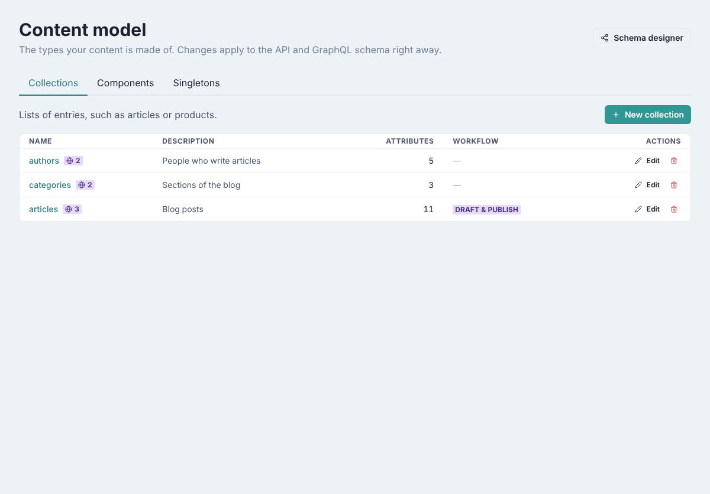

For each type, the list shows:

- its **Name**, with a globe badge counting its localized attributes (attributes that have
  a value per language);
- its **Description** and number of **Attributes**;
- for collections, the **Workflow**: **Draft & publish** when entries are drafted before
  they are published;
- the **Edit** and delete (bin) actions.

Changes to the content model apply to the API right away: there is nothing to deploy.

## Create a collection

As an example, here is how to create an `events` collection for conferences and meetups.

1. On the **Collections** tab, click **New collection**.
2. Under **Settings**, type the **Name**: `events`. Use a lower-case plural; it appears in
   the API's URLs (`/api/collections/events`) and cannot be changed later.
3. Optionally, type a **Description**: `Conferences and meetups`.
4. Turn on **Draft and publish** if entries should be reviewed before they go live. New
   entries then start as drafts, and readers of the API only see published ones.

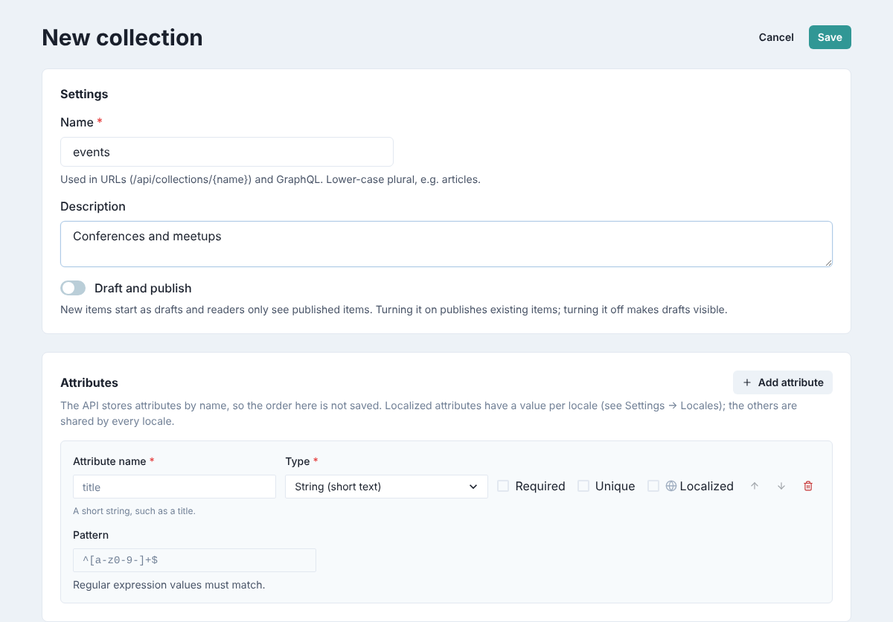

The form starts with one empty attribute. Fill it in, then add the others one by one.

### Add attributes

Each attribute is a field of the entries. For each one:

1. Click **Add attribute** (the first one is already there).
2. Type the **Attribute name**, for example `title`. Use letters, digits and `_`, without
   spaces and not starting with a digit.
3. Choose its **Type**.
4. Tick the options you need:
    - **Required**: an entry can't be saved without a value.
    - **Unique**: two entries can't have the same value (not offered for relations and
      components).
    - **Localized**: the field has a value per language; the other fields are shared by
      every language (not offered for relations).
5. Fill in the settings of the type, if it has any (see below).

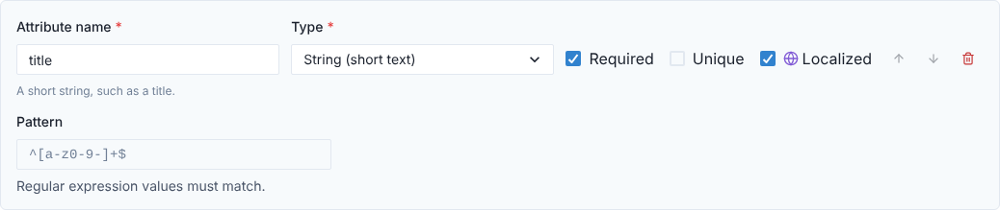

The arrow buttons move an attribute up or down in the form, and the bin removes it.

!!! note
    The order of attributes is not saved: the editor lists them by name the next time you
    open the type.

The types, and the settings each one adds:

| Type | Holds | Settings |
|------|-------|----------|
| **String (short text)** | A title, a name | **Pattern** |
| **Text (long text)** | Plain paragraphs | **Pattern** |
| **Rich text** | Formatted text, such as Markdown | **Pattern** |
| **Email** | An email address | **Pattern** |
| **Password** | A secret, stored as typed | **Pattern** |
| **UID (slug, SKU)** | An identifier such as a URL slug; usually also **Unique** | — |
| **Integer** | A whole number | **Minimum value**, **Maximum value** |
| **Float** | A decimal number | — |
| **Boolean** | Yes or no | — |
| **Date** / **Date and time** | A day, or a moment | — |
| **Enumeration** | One value from a fixed list | **Options** (required) |
| **JSON** | Any structured data | — |
| **Media** | Files from the [media library](media.md) | **Allowed types**, **Multiple files** |
| **Relation** | Links to entries of another collection | **Target collection**, **Relation type** |
| **Component** | A group of fields defined by a component | **Component**, **Repeatable (a list)** |

**Pattern** is a regular expression the value must match, for example `^[a-z0-9-]+$` for
lower-case slugs; leave it empty to accept anything. Each type is described in detail in
[Attribute types](../guides/content-modeling.md#attribute-types).

#### Enumeration

Type one option per line under **Options**. Editors will pick one of them from a list.

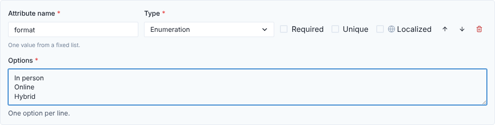

#### Integer

Optionally set a **Minimum value** and a **Maximum value**.

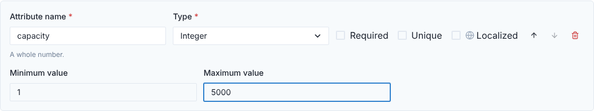

#### Media

**Allowed types** limits the files accepted, as comma-separated file types: `image/*` for
any image, `application/pdf` for PDF documents. Leave it empty to accept any file. Tick
**Multiple files** to allow a list of files (a gallery, attachments); you can then set a
minimum and maximum number of files.

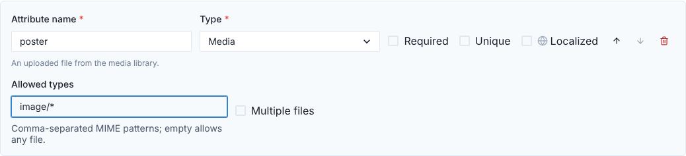

#### Relation

Choose the **Target collection** whose entries this field links to, and the **Relation
type**: **One to one**, **One to many** or **Many to many**. Here, an event has several
speakers, and an author can speak at several events:

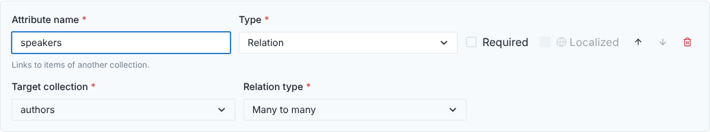

Relations are shared by every language, so they can't be localized. See
[Relations](../guides/content-modeling.md#relations) for what each relation type means.

#### Component

Choose the **Component** to use. Tick **Repeatable (a list)** to hold several of them, for
example a list of links; you can then set a minimum and maximum number of items. If the
list is empty, [create a component](#create-a-component) first.

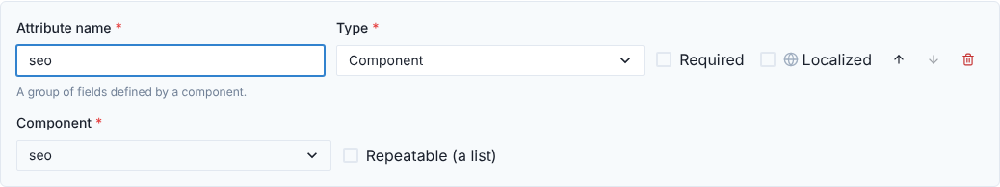

### Save the collection

Click **Save** at the top, or **Save collection** at the bottom of the page.

If something is missing or wrong, nothing is saved: a banner says **Fix the highlighted
fields before saving**, and each problem is shown in red under its field.

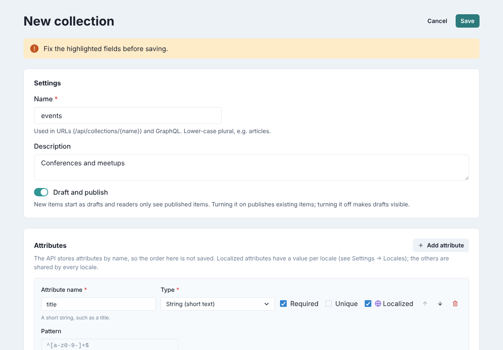

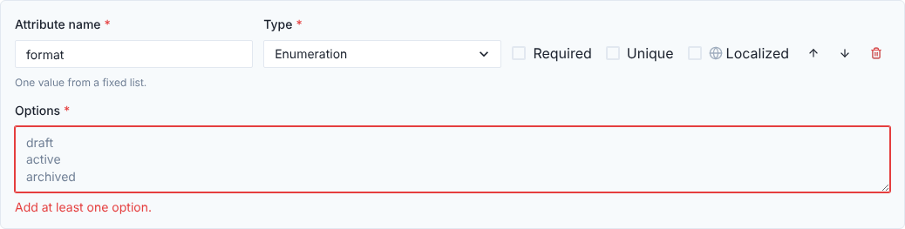

The most common problems:

- an attribute without a name, or with a space or another forbidden character;
- two attributes with the same name;
- a reserved name: `id`, `createdAt`, `updatedAt`, `publishedAt`, and also `status` with
  draft and publish, or `locale` and `locales` when the type has localized attributes;
- an Enumeration without options, a Relation without a target collection, or a Component
  attribute without a component.

Once saved, you are back on the list, with a confirmation at the bottom of the screen. The
new collection is also listed in the content editor, ready for entries.

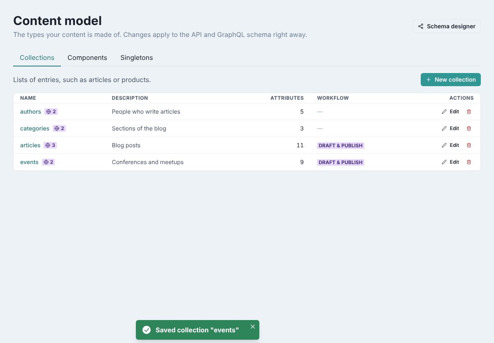

## Edit a collection

1. On the **Collections** tab, click the collection's name or **Edit**.
2. Change the description, the **Draft and publish** setting, or the attributes.
3. Click **Save**.

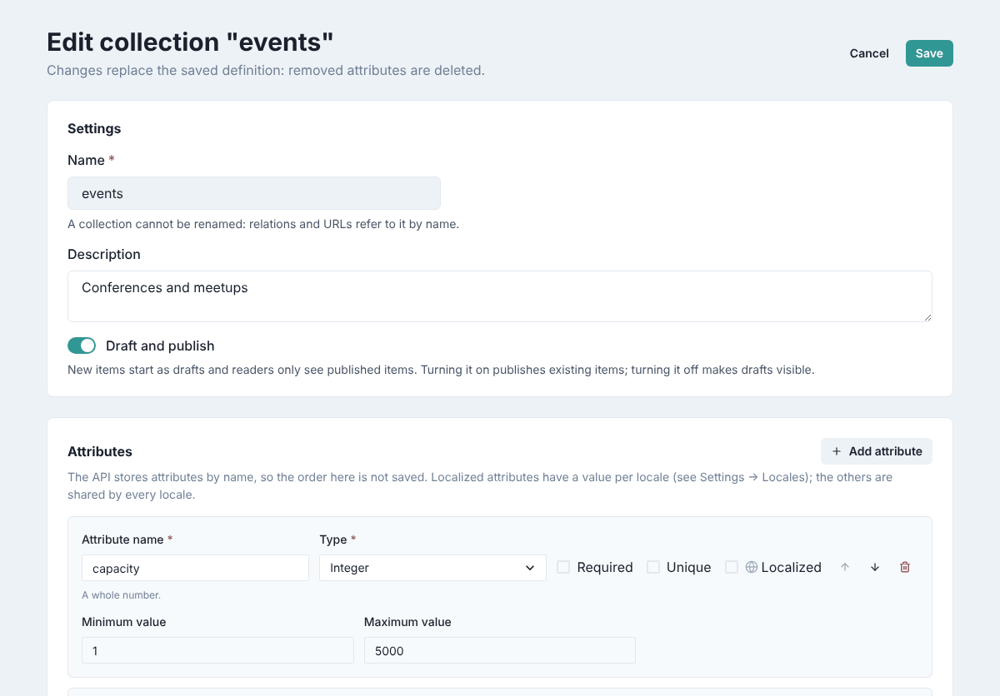

Keep in mind:

- **A collection can't be renamed**: its name is greyed out, because relations and URLs
  refer to it. To rename one, create a new collection and move the content.
- **Saving replaces the whole definition**: an attribute you remove from the form is
  deleted from the collection. Remove attributes only when you no longer need their content.
- **Turning Draft and publish on** publishes the existing entries; **turning it off** makes
  drafts visible to everyone who can read the collection.

## Delete a collection

1. Click the bin icon at the end of the collection's row.
2. Read the warning and click **Delete**.

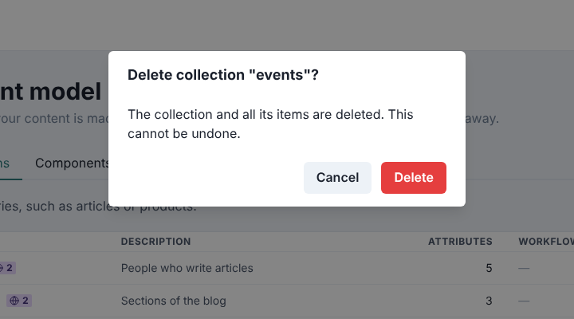

!!! warning
    Deleting a collection deletes all its entries, and it can't be undone.

## Create a singleton

A singleton (a *single type*) has one entry only: the home page, the site settings, a
footer. It works like a collection, without a list and without draft and publish.

1. Open the **Singletons** tab and click **New singleton**.
2. Type the **Name** and, optionally, a **Description**.
3. Add its attributes as for a collection (relations and localized attributes are
   available too).
4. Click **Save singleton**.

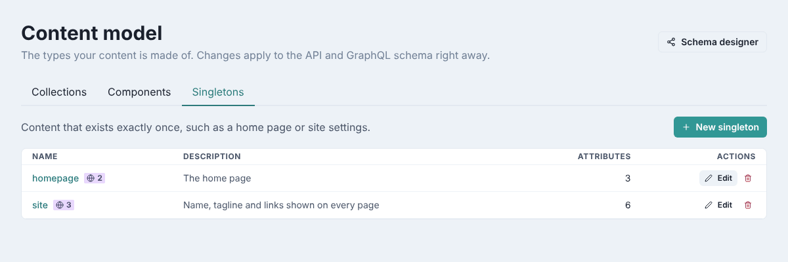

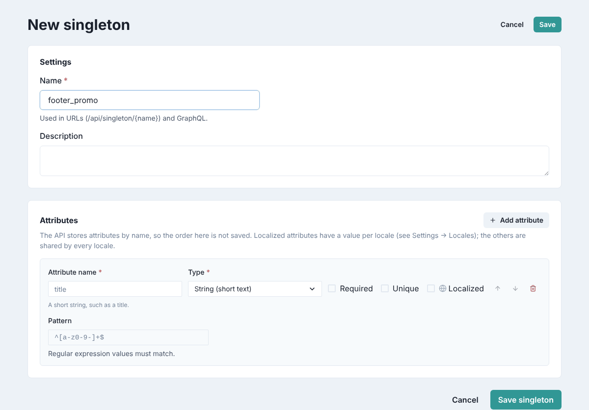

Like collections, singletons can't be renamed once saved. Editors fill them in under
**Single types** in the content editor (see [Edit a single type](editing-content.md#edit-a-single-type)).
More in [Singletons](../guides/content-modeling.md#singletons).

## Create a component

A component is a group of fields you reuse in several types, for example `seo` with a
meta title, a meta description and a share image.

1. Open the **Components** tab and click **New component**.
2. Type the **Name** (for example `seo`) and, optionally, a **Description**.
3. Add its attributes. Components can't contain relations, and their attributes have no
   **Localized** option: a component takes the language of the entry that holds it.
4. Click **Save component**.

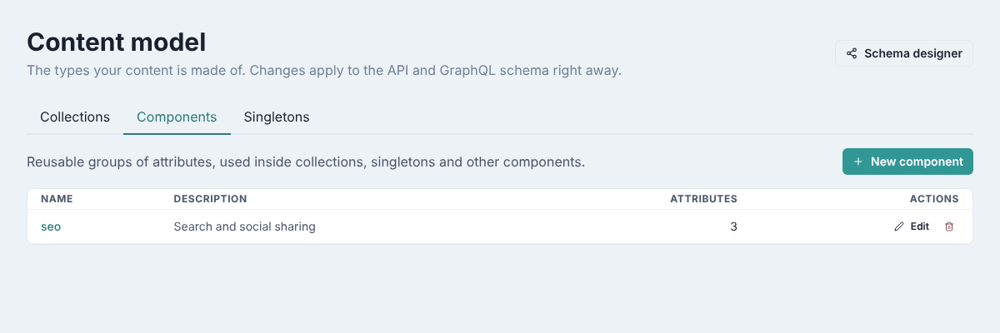

To use it, add an attribute of type **Component** to a collection or a singleton and
choose it (see [Component](#component)).

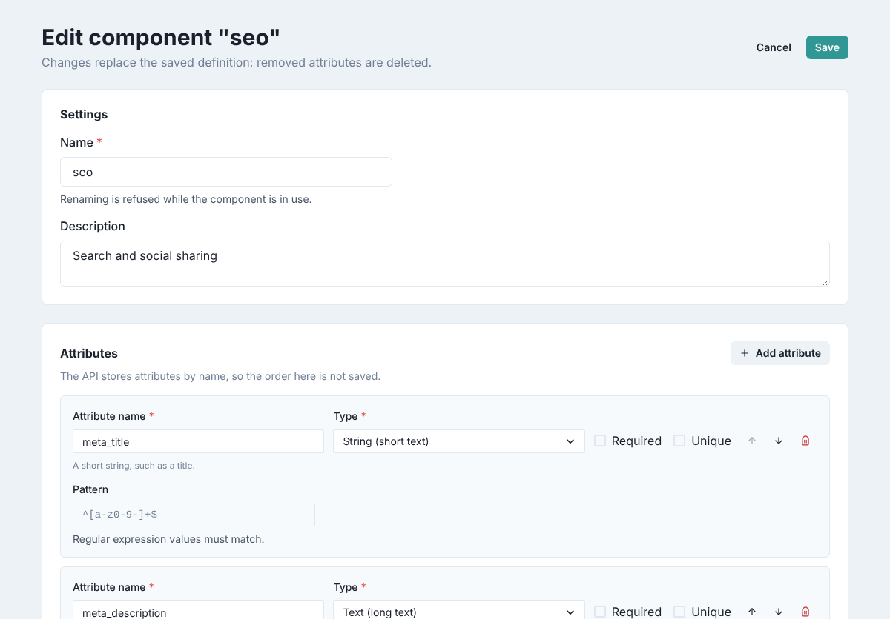

Unlike collections, a component can be renamed, but only while no type uses it. A
component that is in use can't be deleted either. More in
[Components](../guides/content-modeling.md#components).

In the content editor, a component's fields appear in a box of their own (see
[Fill in the fields](editing-content.md#fill-in-the-fields)).

## See the model as a map

**Content Model → Schema Designer** draws your collections as boxes, with their attributes,
the relations between them, and the AI agents they trigger. It's a quick way to check how
the model fits together.

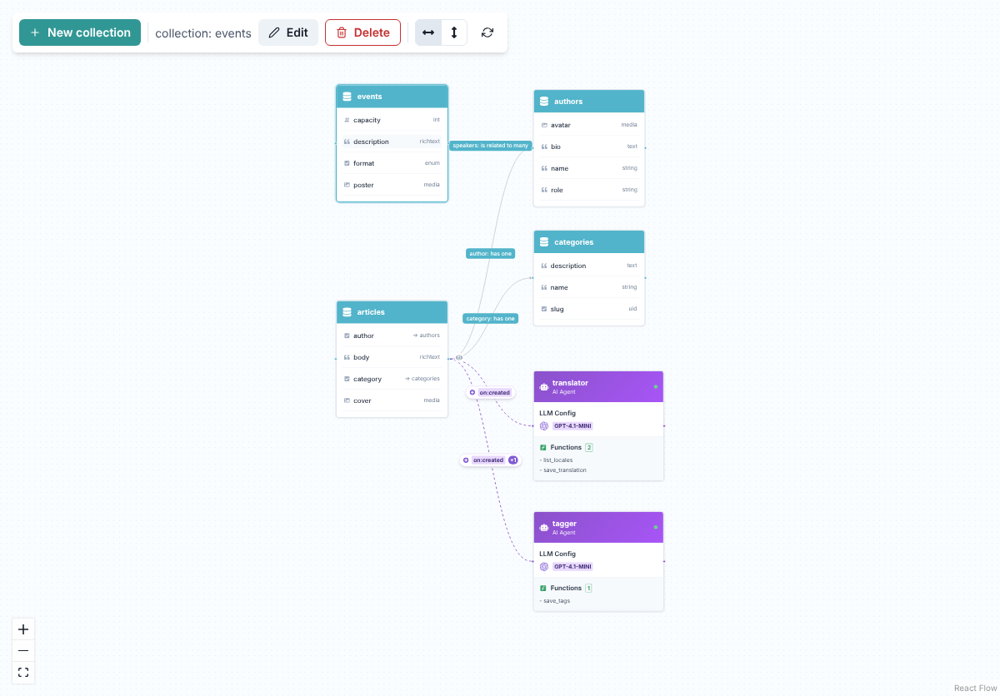

- Labels on the lines describe the relations (for example *speakers: is related to many*);
  dashed lines lead to the agents a collection triggers, labelled with the event (*on:created*).
- Click a box to select it, then use **Edit** or **Delete** in the toolbar. Double-clicking
  a box opens its editor too.
- **New collection** opens the collection form.
- The two arrow buttons lay the map out from left to right or from top to bottom; the
  circular arrow reloads the model.
- Zoom with the **+** and **−** buttons in the bottom-left corner (or the mouse wheel), and
  fit everything on screen with the square button. A box with many attributes scrolls.

You can drag boxes around to read the map more easily, but their positions aren't saved.
The map shows collections and agents only: singletons and components are on the
**Types** page.
