# Editing content

The content editor is where you write, translate and publish entries. **Editors** and
admins can do everything described here; **writers** and other custom roles can do what
their permissions allow (for example, write drafts that an editor publishes); **viewers**
can browse but not change anything. The buttons your role can't use are simply not shown.

## Browse entries

1. In the sidebar, click **Content → Content Editor**.
2. In the list on the left, click a collection under **Collections**, or a single type under
   **Single types**.

The entries of the collection are listed newest first, with their fields as columns. The
header tells you how many there are.

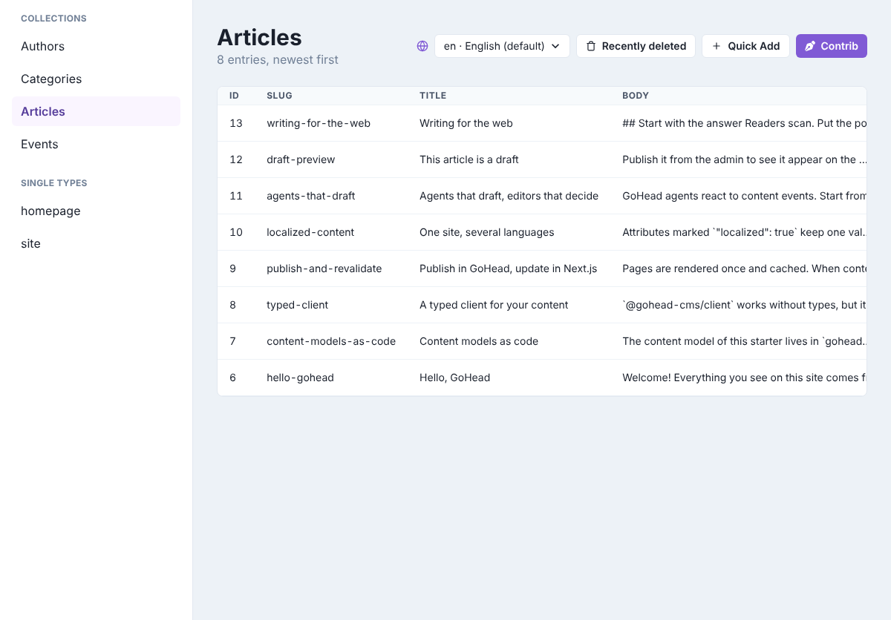

The table is usually wider than the screen: scroll it sideways to reach the last columns.

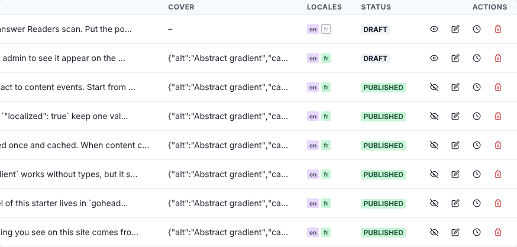

- **Locales** shows which languages each entry is translated into. The default language is
  purple, the translated ones green, and the missing ones greyed out.
- **Status** (only for collections with draft and publish) is **draft** or **published**.
- **Actions** are, from left to right: publish or unpublish (eye), edit (pencil),
  history (clock) and delete (bin).

Only the latest entries are loaded. When there are more, click **Load more** under the
table to see older ones. The content editor has no search or filter.

## Create an entry

There are two ways to create an entry:

- **Quick Add** opens a form in a panel on the right, with every field.
- **Contrib** opens a full-page editor made for writing, with the title and the main text
  in large and the other fields in a side panel.

Both create the same kind of entry: pick the one you prefer.

### With the full-page editor

1. Open the collection and click **Contrib**.
2. Type the title in **Your post title...**, and the main text in
   **Begin writing your content...**.
3. Fill in the other fields in the **Metadata** panel on the right.
4. Click **Save Entry** (or **Save draft**, see [Publish](#publish-and-unpublish)).

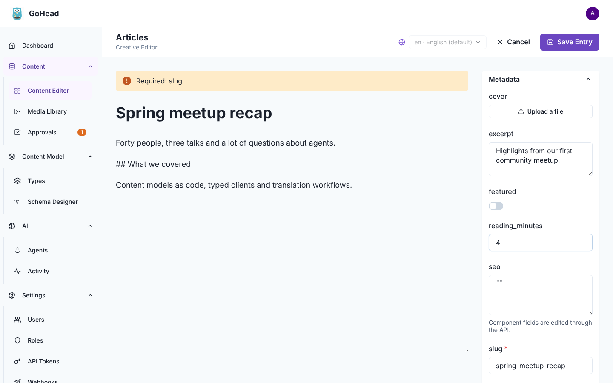

Required fields have a red asterisk. If one is empty when you save, a banner names the
missing fields and nothing is saved: fill them in and save again.

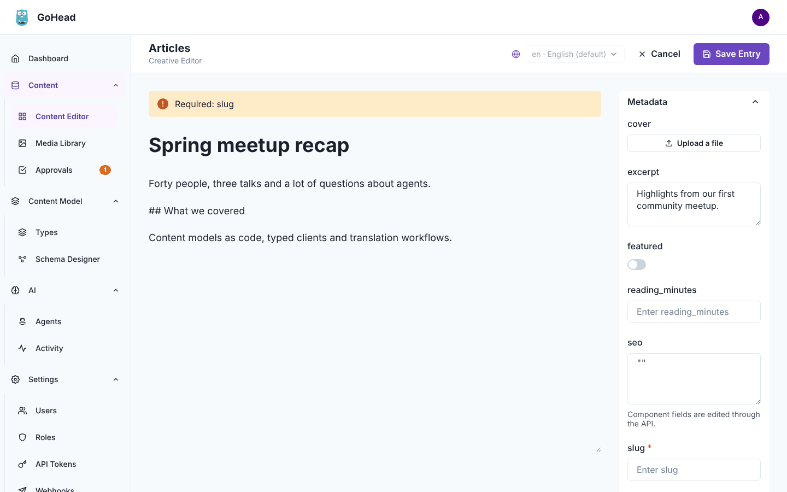

Once saved, you're taken back to the content editor. Click **Cancel** to leave without
saving.

### With Quick Add

1. Open the collection and click **Quick Add**.
2. Fill in the fields. They are listed in alphabetical order, so scroll down to find all
   of them.
3. Click **Save Changes**.

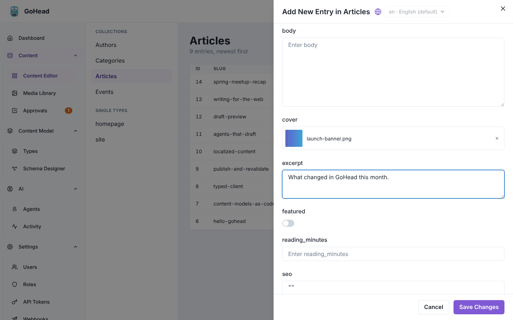

If a required field is empty or a value isn't accepted (a duplicate slug, a number out of
range…), a red message at the bottom of the screen explains why, and the panel stays open
so you can fix it.

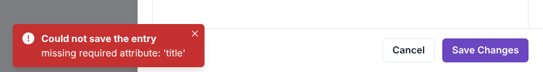

### Fill in the fields

Each type of field has its own input:

| Field | How to fill it in |
|-------|-------------------|
| Text, rich text, slug, email | Type the text. Rich text is written in Markdown (`## Heading`, `**bold**`) |
| Number | Type the number |
| Boolean | Flip the switch |
| Date, date and time | Pick the date (and time) |
| Enumeration | Choose a value in the list |
| Media | Upload a file, or choose one from the library (see below) |
| Relation (an article's author, the articles featured on the home page) | Choose the entries it points to (see below) |
| Component (an article's SEO settings, a list of FAQ items) | Fill in its fields, in a box of their own (see below) |
| JSON (such as an article's tags) | Type JSON, for example `["news", "go"]` (see below) |

To set a **media** field, click **Upload a file** (or **Upload files** when the field takes
several) and choose a file on your computer: it is uploaded to the
[media library](media.md). Or click **Choose from library** to use a file already there:
search by name, click the file (or several, then **Add**). The field shows each file with a
preview; the × button removes it from the entry (the file stays in the library). Only the
kinds of files the field accepts can be chosen.

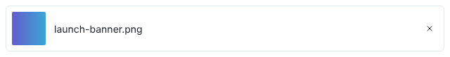

A **relation** field shows the entries it points to, by name, with their ID (and a
*draft* badge for unpublished ones). Its label says which collection it points to, and
"(several)" when it takes more than one.

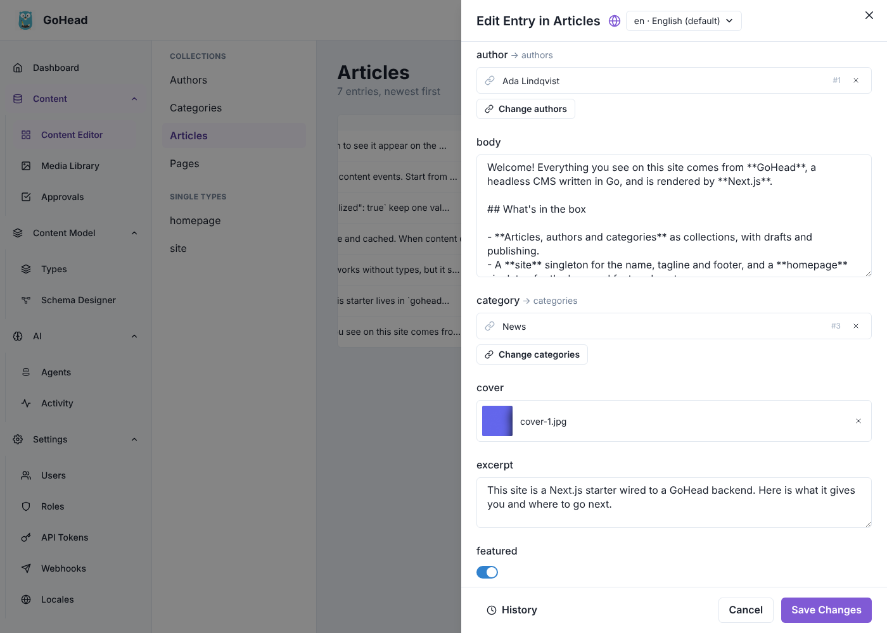

- Click **Choose** (or **Change**) to pick the entry: a window lists the collection's
  entries, newest first; type to search them by name, and click one.
- In a field that takes several (**Add …**), click each entry you want, then **Add**.
  Entries already in the field are greyed out.
- The × button takes an entry off the field (the entry itself is not deleted).

If your role can't read the collection a relation points to, the field shows a warning
instead: the relation is hidden from you, and saving the entry would clear it, so leave such
entries to someone who can see the whole entry.

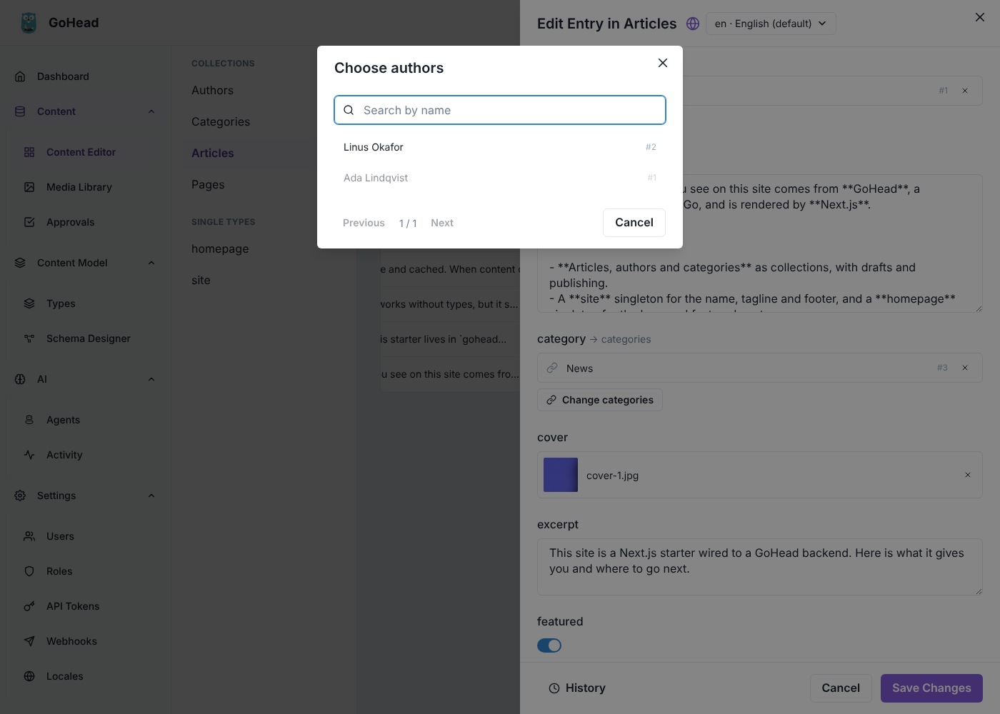

A **component** groups fields that go together. Its fields appear in a grey box: fill
them in like the others. An empty component shows an **Add …** button; the bin icon clears
it. A component that repeats (a list of FAQ items, say) shows one box per item, with
**Add …** at the bottom and arrows to reorder the items.

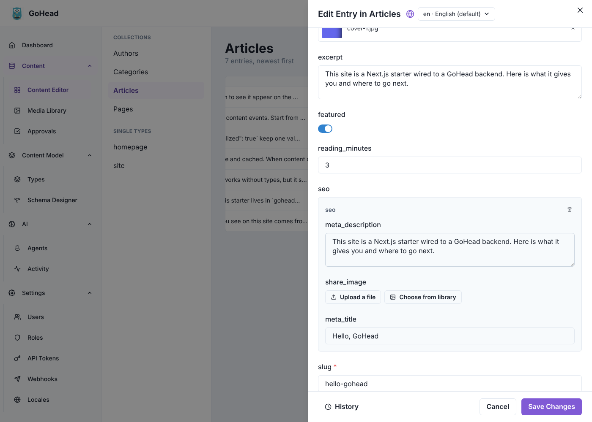

A **JSON** field takes any JSON value: a list (`["news", "go"]`), an object
(`{"theme": "dark"}`), a number… While the text is not valid JSON the field is outlined in
red with the reason, and the entry can't be saved. Leave the field empty (or type `null`)
to unset it.

## Publish and unpublish

In a collection with draft and publish, new entries are **drafts**: readers of the website
don't see them until they are published.

1. Find the entry in the list (scroll the table to the right).
2. Click the eye icon, **Publish**.

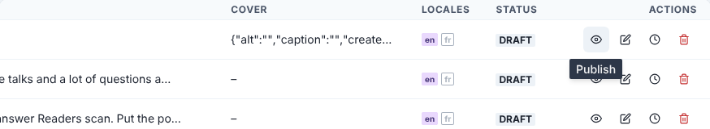

The status changes to **published**, and the eye is now crossed out: click it to
**Unpublish** the entry and take it off the website.

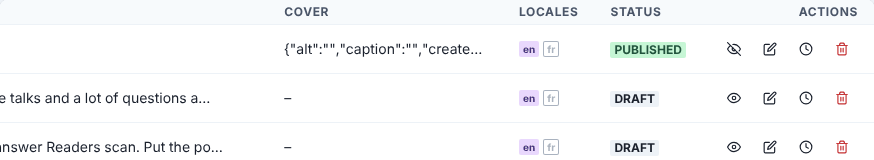

!!! warning "Edits to a published entry are live"
    An entry has a single version: saving changes to a published entry changes what
    readers see right away. To prepare changes privately, unpublish it first. See
    [Draft and publish](../guides/content-modeling.md#draft-and-publish).

If your role can't publish (a writer, for example), the save button reads **Save draft**,
with the reminder *Your role cannot publish: an editor publishes it.* Ask an editor to
review and publish your entry. Such roles can't edit an entry once it is published.

## Edit an entry

1. Find the entry in the list and click the pencil icon, **Edit**.
2. Change the fields.
3. Click **Save Changes**.

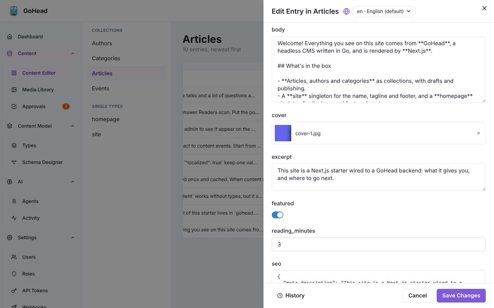

The fields are in alphabetical order: scroll down for the title and the slug.

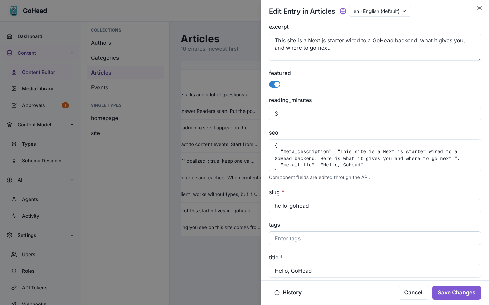

**Cancel** (or the × in the corner) closes the panel without saving.

## Edit a single type

A single type, such as the home page or the site settings, has one entry, edited in place.

1. Under **Single types** on the left, click the single type.
2. Change the fields.
3. Click **Save**.

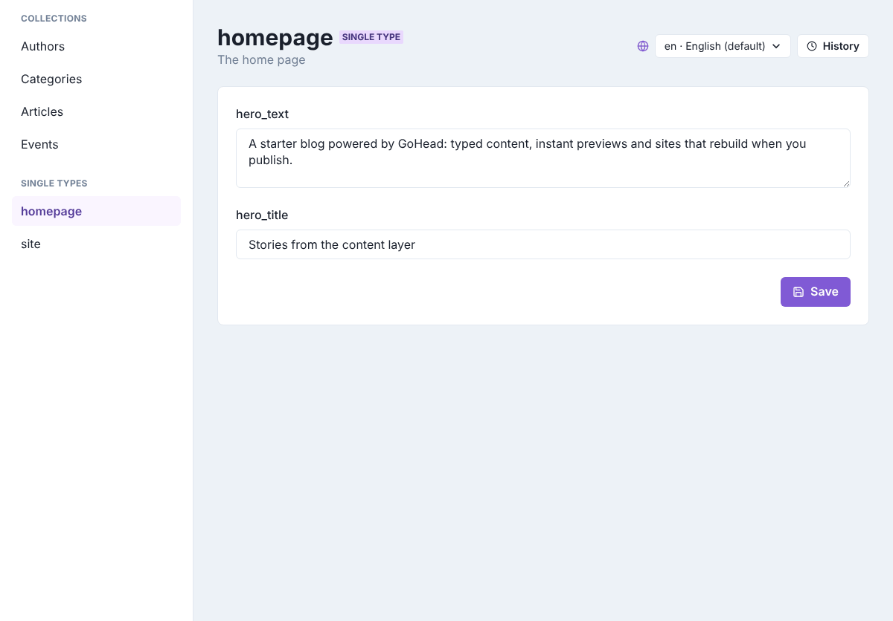

When it has no content yet, fill in the fields and click **Save** to create it. Single
types have the same locale switcher and **History** as entries, described below.

## Translate an entry

When GoHead has several languages (*locales*) and a collection has localized fields, each
entry can be translated. An entry is always created in the default language first; you
then add its translations.

1. Open the entry with the pencil icon.
2. In the language list at the top of the panel, choose the language, for example
   **fr · Français**. A ✓ marks languages that already have a translation, and
   *(not translated)* those that don't.
3. Type the translated values. Under each field you see the default-language value for
   reference.
4. Click **Save translation**.

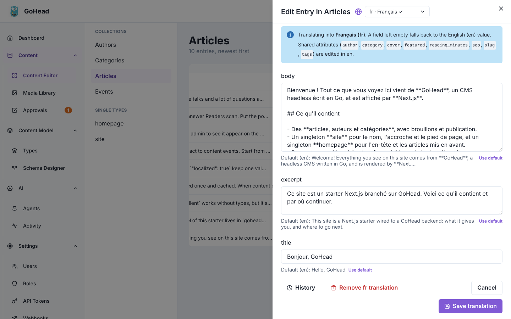

Things to know:

- Only **localized** fields are shown. The others (the slug, the cover, the relations…) are
  shared by every language and edited in the default language, as the blue banner lists.
- A field left empty **falls back** to the default-language value. **Use default** under a
  field clears it, so it falls back again.
- **Remove fr translation** deletes every French value of the entry; French readers then
  get the default language.
- If you switch language with unsaved changes, GoHead asks first: **Keep editing**, or
  **Discard and switch**.

To read the whole list in another language, choose it in **View in locale** at the top of
the list. Titles and texts are then shown in that language, falling back to the default
language where there is no translation.

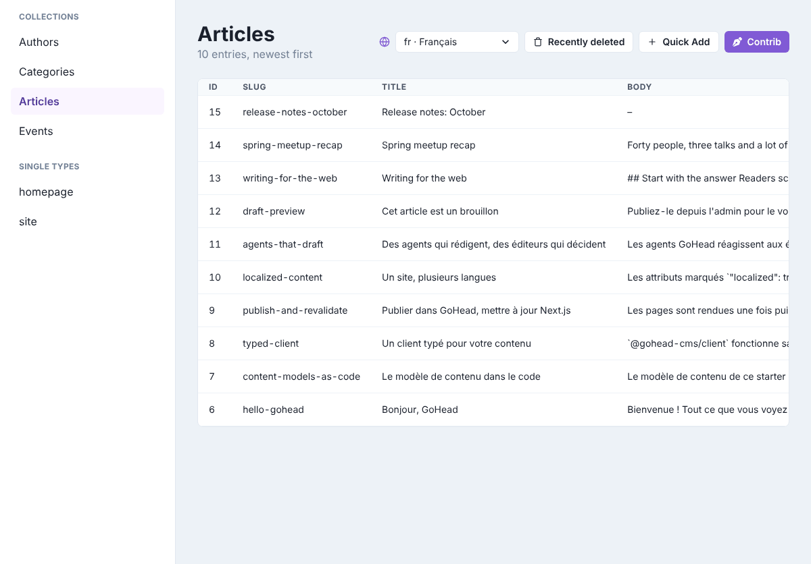

Languages are added by admins (**Settings → Locales**). More in
[Localization](../guides/localization.md#in-the-admin-ui).

## Compare versions and restore one

Every change to an entry is kept as a **version**: who made it, when, and what it changed.
You can compare versions and bring an older one back. This needs a role that can edit the
collection.

1. Click the clock icon, **History**, on the entry's row (or **History** at the bottom of the
   Edit Entry panel, or at the top of a single type).
2. The versions are listed on the left, newest first, each with its action (create,
   update, restore…), its status and its author. The current one is marked **current**.
3. Click a version to see **Changes in this version**: each changed field, before and
   after. Words removed are struck through in red, words added are highlighted in green.

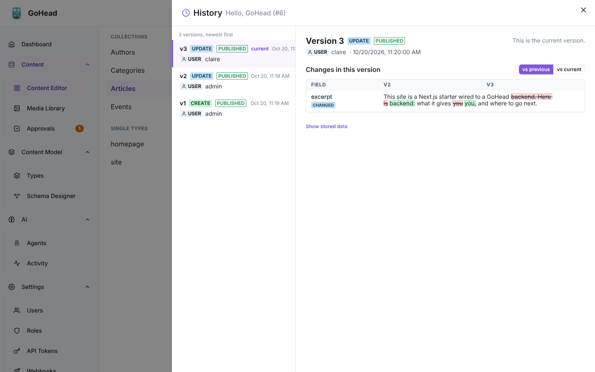

To see what restoring an older version would do, select it and click **vs current**: the
table then compares it with the current content.

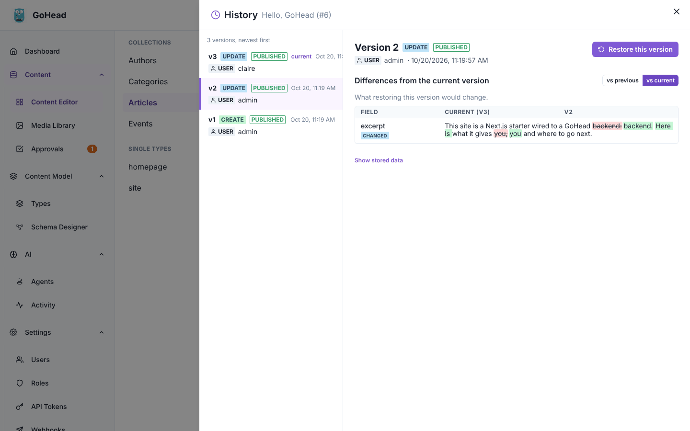

To restore it:

1. Select the version and click **Restore this version**.
2. Confirm with **Restore**.

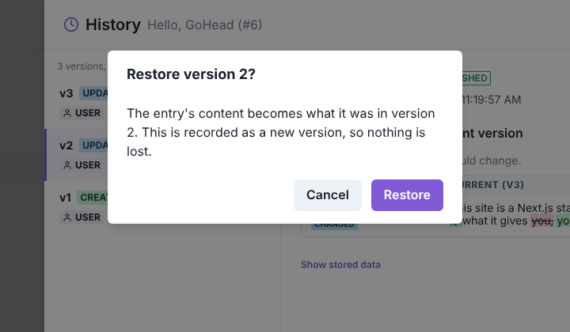

The entry's content becomes what it was in that version. Nothing is lost: the restore is
recorded as a new version (*restored from v2*), which you can undo the same way.

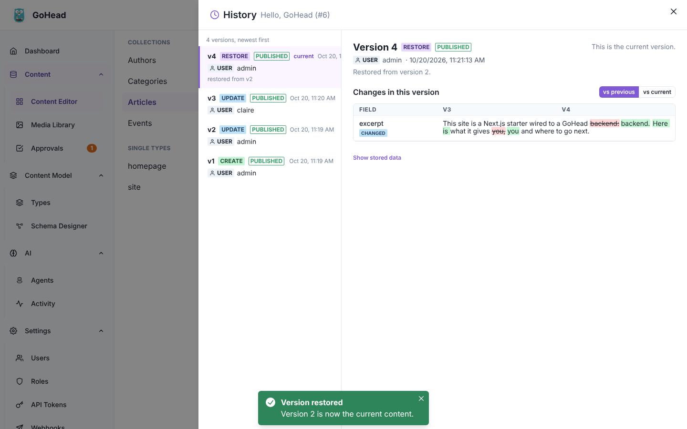

**Show stored data** displays the complete content of a version. More in
[Content history](../guides/content-history.md#in-the-admin-ui).

## Delete an entry and bring it back

1. Click the bin icon on the entry's row.
2. Click **Delete** to confirm.

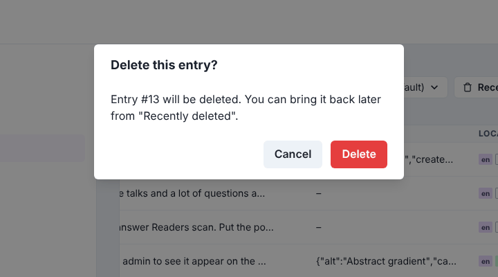

A deleted entry can be brought back:

1. In the collection's header, click **Recently deleted**. It lists the entries deleted
   lately, who deleted them and when.
2. Click **Restore** next to the entry.

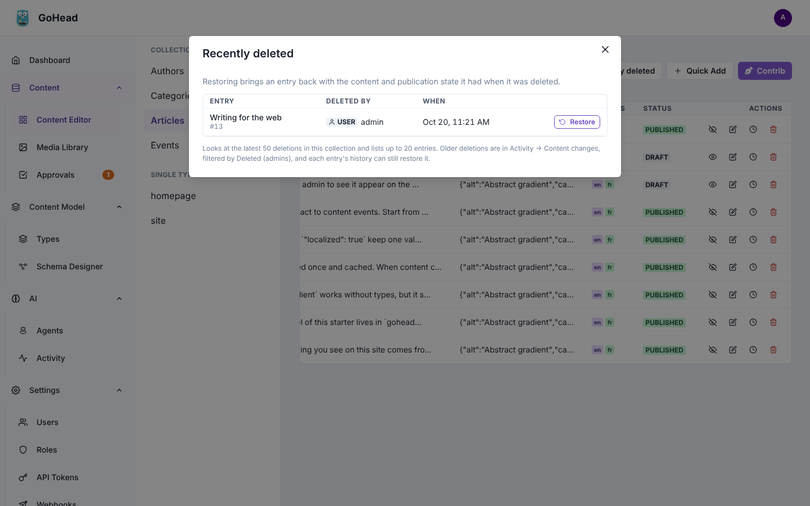

The entry comes back with the content and the status (draft or published) it had when it
was deleted. Bringing back a published entry needs a role that can publish.

!!! tip
    **Recently deleted** only looks at the latest deletions. Admins find older ones under
    **AI → Activity → Content changes**, filtered on deletions; each entry's history can
    restore it as well.
