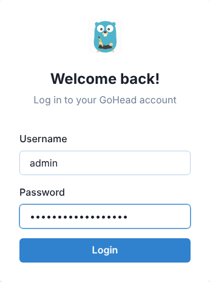
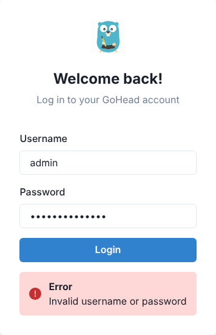
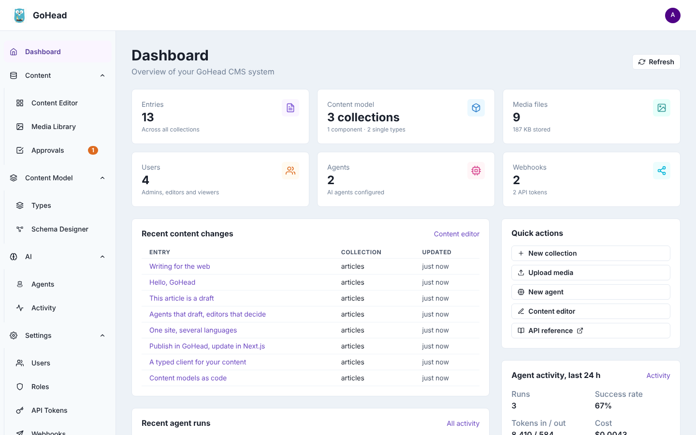
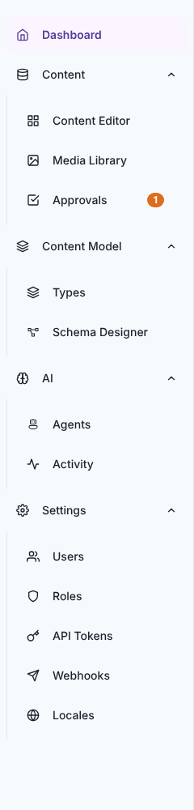
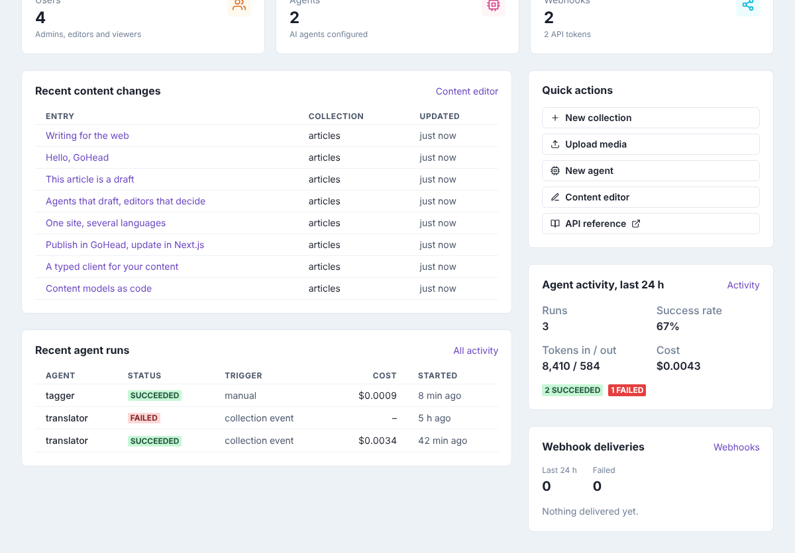
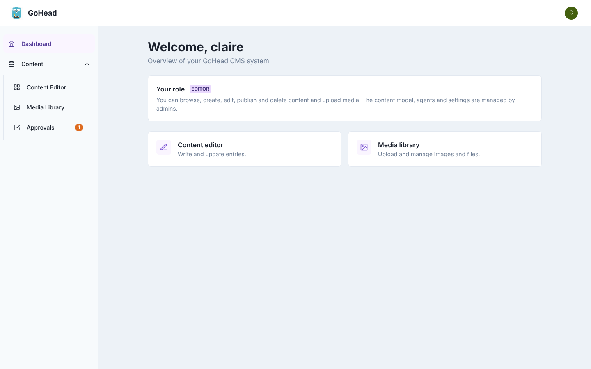
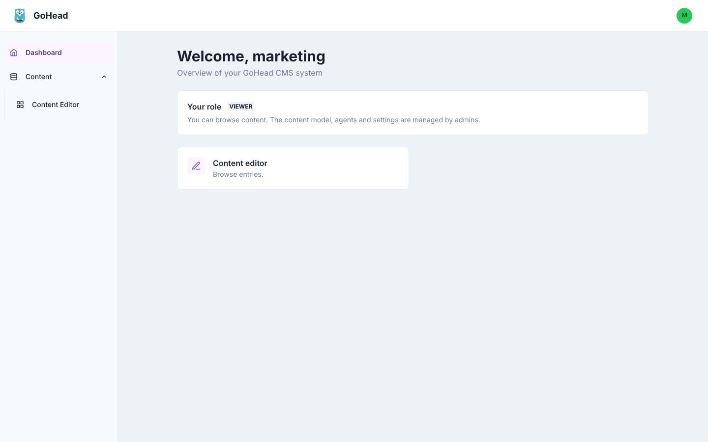
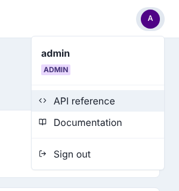

# Getting started

The admin UI is where you write content, manage files and, as an admin, design the
content model and configure GoHead. Everyone with a GoHead account can sign in; what you
see once inside depends on your role.

## Open the admin UI

Open the address of your admin UI in a web browser. With the default Docker Compose setup
it is <http://localhost:3000>; otherwise ask whoever runs GoHead for the address. (Admins:
see [Admin UI → Run it](../guides/admin-ui.md#run-it).)

## Sign in

1. Type your **Username** and **Password**.
2. Click **Login**.

If the username or password is wrong, the form shows **Invalid username or password**.
Check both and try again. If you have forgotten your password, ask an admin to reset it:
there is no self-service reset.

After signing in you land on the **Dashboard**. You stay signed in in this browser until you
sign out or your session expires; an expired or revoked session takes you back to the
sign-in page.

## Find your way around

The screen has three parts:

- the **header**, with the GoHead logo on the left and your account menu (your initial in a
  circle) on the right;
- the **sidebar** on the left, with the sections you can use;
- the **page** itself, in the middle.

The sidebar groups pages into sections. Click a section name (**Content**, **Content
Model**, **AI**, **Settings**) to fold or unfold it; the page you are on is highlighted.

<figure markdown>
{ width="240" }
</figure>

| Section | Page | What it is for |
|---------|------|----------------|
| | **Dashboard** | An overview, and shortcuts to common tasks |
| Content | **Content Editor** | Browse, write, translate and publish entries ([Editing content](editing-content.md)) |
| | **Media Library** | Upload and manage images and files ([Media library](media.md)) |
| | **Approvals** | Review changes proposed by AI agents. The orange badge counts those waiting |
| Content Model | **Types** | Collections, components and single types ([Content model](content-model.md)) |
| | **Schema Designer** | A map of the content model ([Content model](content-model.md#see-the-model-as-a-map)) |
| AI | **Agents**, **Activity** | AI agents, their runs, and every content change |
| Settings | **Users**, **Roles**, **API Tokens**, **Webhooks**, **Locales** | People, permissions, API access, notifications and languages |

### What your role shows you

The sidebar only lists the pages your role can use:

| Role | Sidebar |
|------|---------|
| **admin** | Everything |
| **editor** | Dashboard, Content Editor, Media Library, Approvals |
| **viewer** | Dashboard, Content Editor (read only) |
| custom role | Dashboard and Content Editor, plus **Media Library** if the role can read media, and **Approvals** if it can create, edit or delete some content |

The content model, AI and settings sections are for admins only. Roles and their
permissions are explained in [Users & roles](../guides/users-and-roles.md#roles).

!!! note
    On a narrow window (a phone, or a small browser window) the sidebar is hidden: open it
    with the menu button in the top-left corner.

## Read the dashboard

### As an admin

The admin dashboard gives an overview of the whole instance:

- six counters at the top: **Entries**, **Content model**, **Media files**, **Users**,
  **Agents** and **Webhooks**;
- **Recent content changes**: the last entries changed; click a title to open it in the
  content editor;
- **Recent agent runs** and **Agent activity, last 24 h**: what AI agents did, whether it
  worked, and what it cost;
- **Webhook deliveries**: notifications sent to other services in the last 24 hours, and
  how many failed;
- **Quick actions**: shortcuts to **New collection**, **Upload media**, **New agent**,
  **Content editor** and the **API reference**.

Click **Refresh** at the top right to load the latest numbers.

### As an editor, a viewer or another role

Other roles get a welcome page instead. **Your role** names your role and sums up what it
allows, and the shortcuts below it open the pages you can use.

A viewer only reads content, so the only shortcut is the content editor:

## Use the account menu and sign out

Click your initial in the top-right corner to open the account menu. It shows your
username and role, and links to:

- **API reference**: the interactive reference of the API this admin UI uses;
- **Documentation**: this handbook;
- **Sign out**.

{ width="300" }

To sign out, open the account menu and click **Sign out**. You go back to the sign-in
page. Sign out when you use a shared computer: otherwise the session stays open in that
browser.

!!! note
    The admin UI is in English and uses a light theme; it has no language or theme setting.
    The language of your *content* is a different matter: see
    [Translate an entry](editing-content.md#translate-an-entry).
