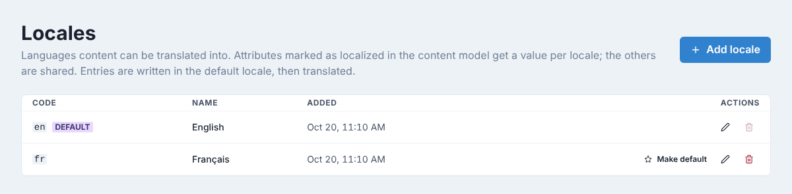
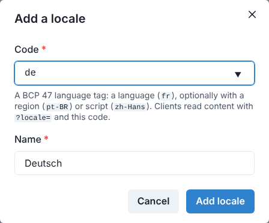
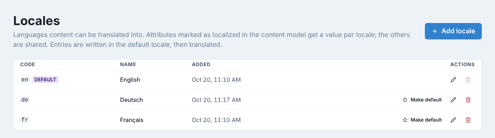
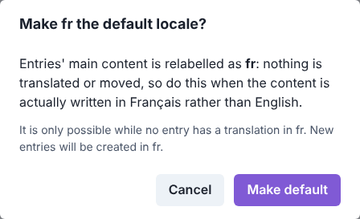
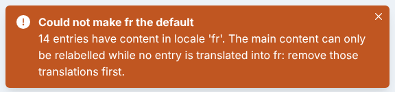

# Locales

Locales are the languages your content can be translated into. Entries are written in the
**default locale**, then translated field by field into the others. Only admins manage
locales, under **Settings → Locales**; editors then translate in the content editor.

Which fields can be translated is decided in the content model: only fields marked
**Localized** get a value per locale; the others are shared by every language.

## Add a locale

1. Click **Add locale**.
2. Type the **Code**: a language (`fr`), optionally with a region (`pt-BR`) or a script
   (`zh-Hans`). Common codes are suggested as you type, and picking one fills in the name.
3. Check the **Name**, as editors will see it (`Deutsch`).
4. Click **Add locale**.

The new locale is ready to use right away: no entry has content in it yet.

The code cannot be changed later, since websites and apps ask for content with it
(`?locale=de`). The name can: click the pencil next to the locale.

## Set the default locale

The default locale is the language entries are written in first. Change it only when the
main content is really written in another language, for example right after setting up a
site whose content is in French.

1. Click **Make default** next to the locale.
2. Read the confirmation and click **Make default**.

Nothing is translated or moved: the main content of every entry is simply labelled with the
new code, and new entries are created in it. That is why it is only possible while no entry
has a translation in that locale. Otherwise GoHead refuses and says how many entries have
one:

## What changes in the editor

As soon as there are two locales, the content editor shows a locale switcher on types with
localized fields, and the content list shows which locales each entry has. In another
locale, editors only change the localized fields, with the default-locale text shown for
reference. See [Translate an entry](editing-content.md#translate-an-entry).

## Delete a locale

Click the red bin next to the locale and confirm. If entries have translations in it,
GoHead asks again before deleting them with the locale; the default-locale content is
always kept. The default locale itself cannot be deleted: make another locale the default
first.

For how websites read and write translations, see [Localization](../guides/localization.md).
