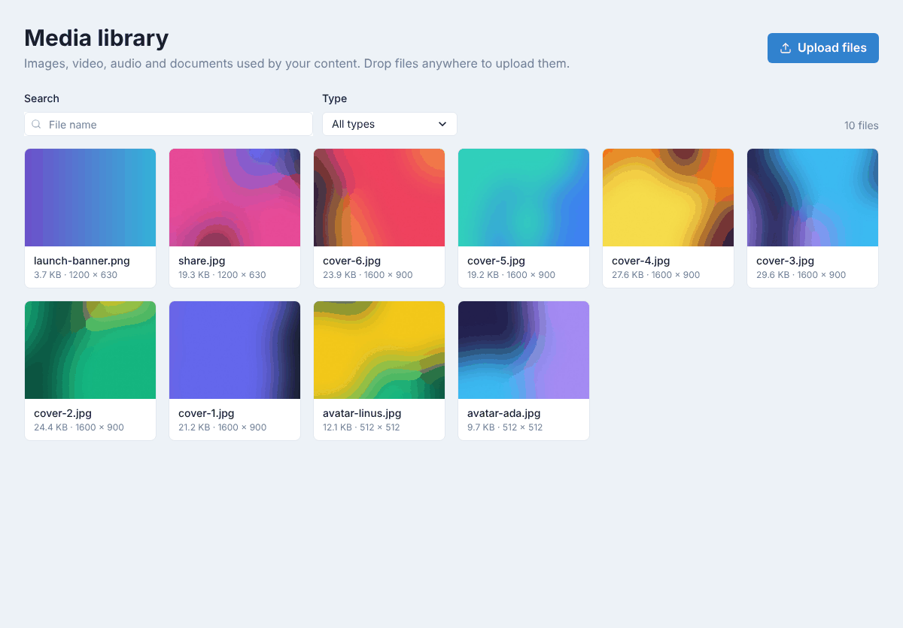
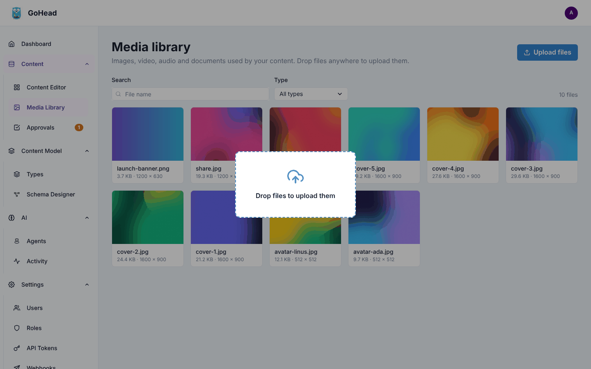
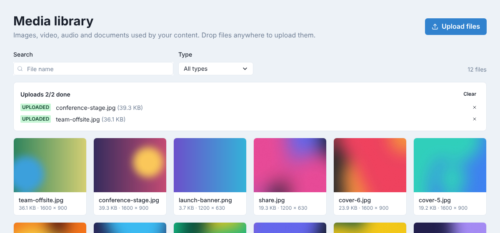
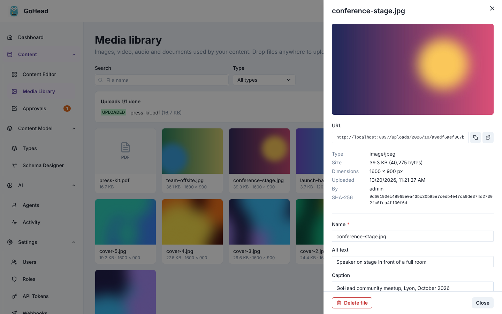
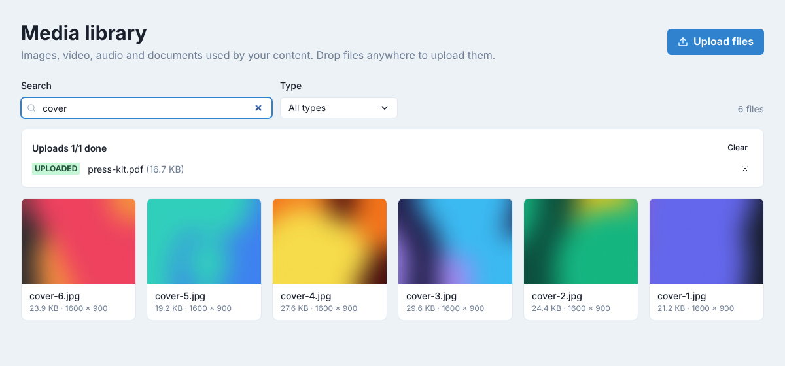
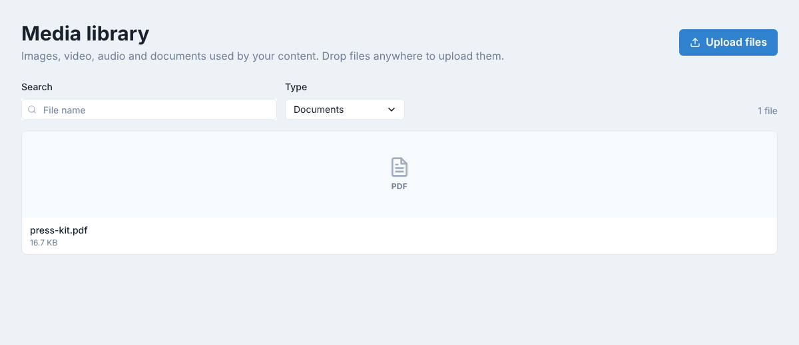
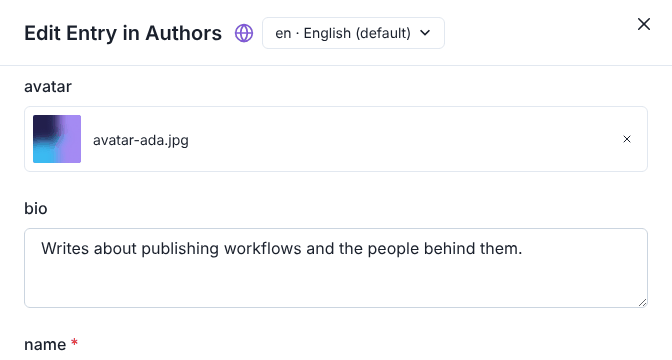
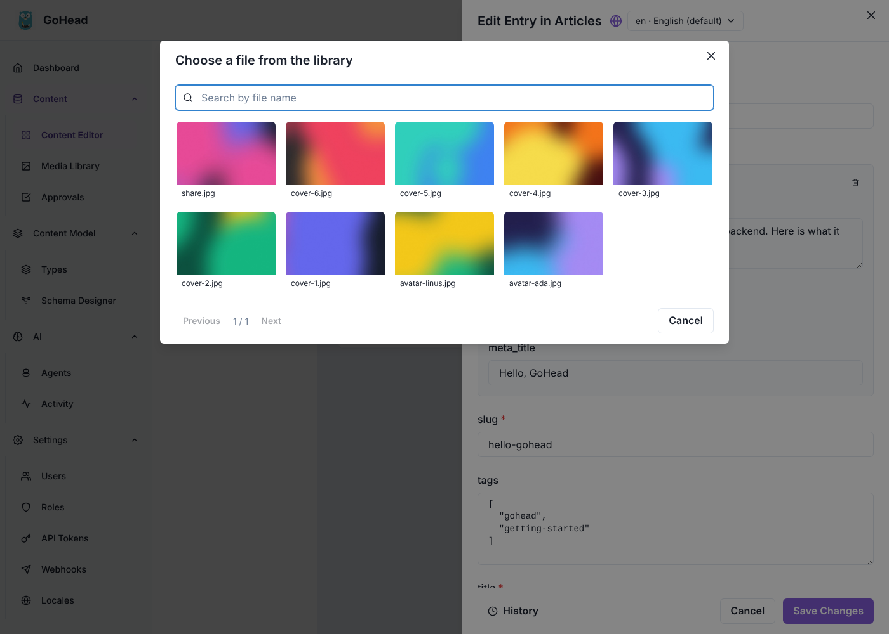
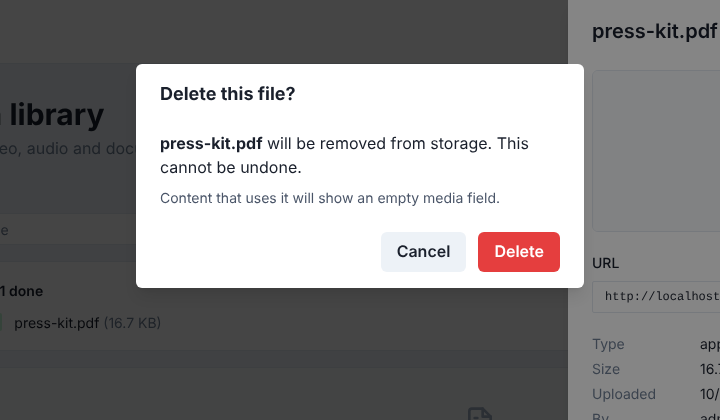

# Media library

The media library holds the images, videos, audio files and documents your content uses.
**Editors** and admins can upload, describe and delete files; custom roles can do what
their media permissions allow (a writer, for example, may upload but not delete).
**Viewers** don't see the media library.

## Open the media library

In the sidebar, click **Content → Media Library**. Files are shown as cards, newest first,
with their name, size and, for images, their dimensions. The total number of files is on
the right.

When there are more files than fit on a page, **Previous** and **Next** below the grid move
between pages.

## Upload files

### By drag and drop

1. Select one or more files on your computer.
2. Drag them anywhere over the media library page. A frame appears: **Drop files to upload
   them**.
3. Drop them.

### With the button

1. Click **Upload files**.
2. Choose one or more files, and confirm.

### Follow the uploads

The **Uploads** panel above the grid follows each file: **Waiting**, **Uploading**,
**Uploaded** or **Failed**, with the reason when an upload fails (a file too large, for
example). The new files appear at the start of the grid. Click **Clear** to hide the
panel, or × to remove one line.

Supported file types and size limits are set by your admin: see
[Media → Configuration](../guides/media.md#configuration).

## Describe a file

Alternative text and captions make images accessible and give the website text to show
with them.

1. Click a file's card. Its details open on the right.
2. Change the **Name**, and type the **Alt text** (a description of the image for people
   who can't see it) and the **Caption**.
3. Click **Save details**. The button is active once something has changed.

The details also show the file's **URL**, with buttons to copy it or open the file in a new
tab, and facts about the file: **Type**, **Size**, **Dimensions**, when it was
**Uploaded** and **By** whom. Click **Close** (or ×) when you are done.

## Find a file

- **Search**: type part of a file name. The grid updates as you type.
- **Type**: show only **Images**, **Video**, **Audio**, **Documents** or **Text**, or go back
  to **All types**.

When nothing matches, click **Clear filters** to see every file again.

## Use a file in an entry

Files reach entries through their **media fields**, such as an article's cover or an
author's avatar (see [Editing content](editing-content.md#fill-in-the-fields)):

1. Open the entry in the [content editor](editing-content.md).
2. In the media field, click **Upload a file** (or **Upload files**) and choose the file
   on your computer, or click **Choose from library** to use a file already in the
   library.
3. Save the entry.

An uploaded file goes to the media library at the same time. The field shows the file's
preview and name; to take it off the entry, click × next to it and save.

**Choose from library** opens the library in a window: search by file name, then click a
file (in a field that takes several, click each one, then **Add**). Files the field doesn't
accept, and those already in it, are greyed out.

!!! tip
    To use an image in a rich-text field, open it in the media library and copy its
    **URL**.

How media fields are defined and how the API returns files is described in
[Media attributes](../guides/media.md#media-attributes).

## Delete a file

1. Click the file's card.
2. At the bottom of the details, click **Delete file**.
3. Click **Delete** to confirm.

!!! warning
    Deleting a file removes it from storage, and it can't be undone. Entries that used it
    show an empty media field: check where a file is used before deleting it.
