# Users and roles

Every person who signs in to the admin UI has an account with a **role**, and the role
decides what they may do. A special **public** role decides what visitors without an account
or token can read through the API. Only admins manage users and roles, under **Settings**.

## Roles at a glance

GoHead comes with three built-in roles, which cannot be changed or deleted:

| Role | Can |
|------|-----|
| **admin** | everything, including the content model, agents, users, tokens and settings |
| **editor** | create, edit, publish and delete all content; manage media |
| **viewer** | read all content |

When none fits, create a [custom role](#create-a-custom-role): for example a writer who
drafts articles but cannot publish them.

## Users

Open **Settings → Users** to see everyone who can sign in, with their role and when the
account was created. Your own account is marked **you**.

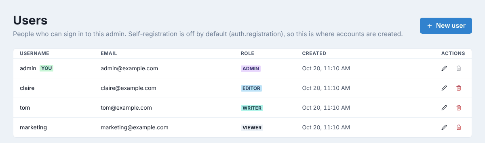

### Add a user

There is no invitation email: you create the account and send the person their username and
password yourself.

1. Click **New user**.
2. Fill in **Username**, **Email** and **Password** (at least 6 characters).
3. Pick a **Role**. The line under the list explains what the role allows.
4. Click **Create user**.

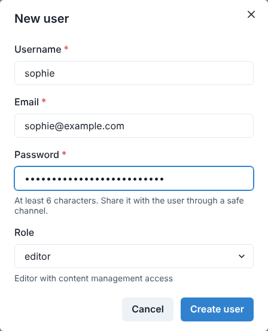

Send the password through a safe channel (a password manager, not a chat message). The
person can sign in right away.

!!! note
    The username cannot be changed later, and cannot contain `:`.

### Change a role, an email or a password

1. Click the pencil next to the user.
2. Change the **Email**, type a **New password** (leave it empty to keep the current one),
   or pick another **Role**.
3. Click **Save changes**.

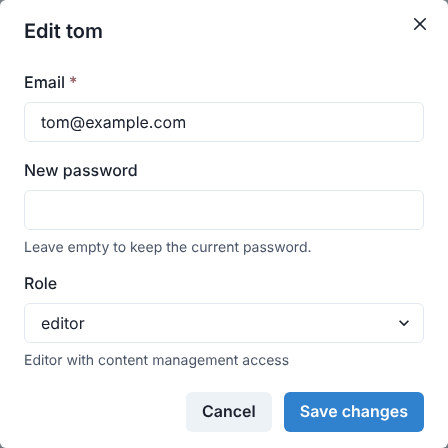

The new role applies within a few seconds, without the person having to sign in again.
You cannot change your own role: another admin must do it, so there is always an admin left.

### Remove a user

1. Click the red bin next to the user.
2. Confirm with **Delete**.

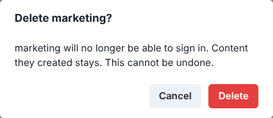

The person can no longer sign in; the content they created stays. This cannot be undone,
and you cannot delete your own account.

!!! tip "No deactivation"
    GoHead has no "disabled" state for accounts. To take access away from someone for a
    while, delete the account and create it again later, or give it the **viewer** role.

## Roles

Open **Settings → Roles**. The table lists the built-in and custom roles with a summary of
their permissions; the **Public** card below it is described in
[Open content to the public](#open-content-to-the-public).

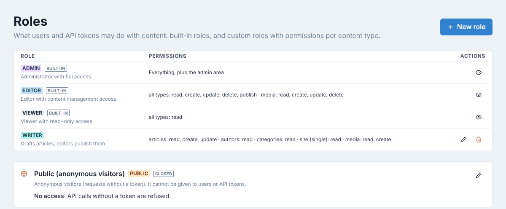

Click the eye next to a built-in role to see its permissions. Custom roles have a pencil to
edit them and a bin to delete them.

### Create a custom role

1. Click **New role**.
2. Type a **Name**: lowercase letters, digits, `-` and `_`, starting with a letter. It cannot
   be changed later.
3. Add a **Description**, shown next to the role wherever it can be picked.
4. Set the **Permissions** (see below).
5. Click **Create role**.

The permission matrix has one row per content type and one column per action: **Read**,
**Create**, **Update**, **Delete** and **Publish**.

- **All other types (\*)** applies to every type that has no settings of its own, including
  types created later. Rows that follow it are faded and say *Same as all other types*.
  Change one of their boxes and the row gets its own settings.
- **Collections** have all five actions. **Single types** only have **Read** and **Update**.
- **Media library** decides whether the role can browse, upload, edit and delete files.
- Any action includes reading: checking a box also checks **Read**, and unchecking **Read**
  clears the row.

Each row has a **Preset** menu to fill it in one click: **No access**, **Read only**,
**Writer (no publish)** or **Editor**. **Same as all other types** gives a row back to the
\* row. The media row has its own presets, from **No access** to **Full**.

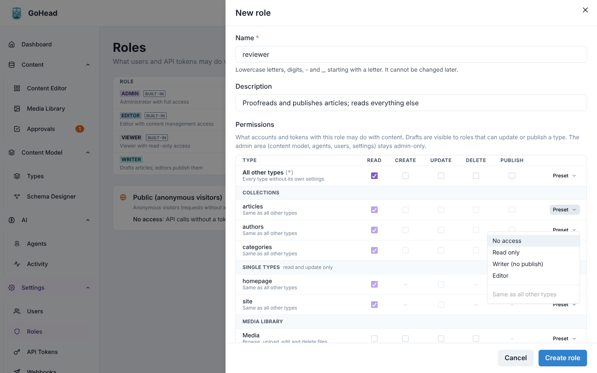

The example below is a *reviewer*: it reads everything, writes and publishes articles,
updates the *site* single type and browses the media library.

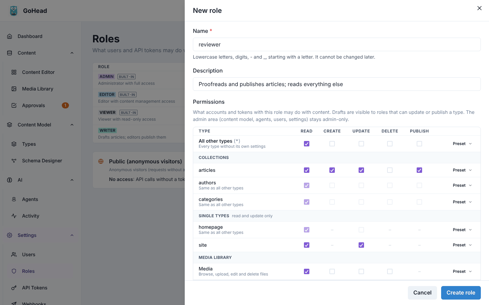

Drafts are visible to roles that can update or publish a type; the others only see
published content. Whatever the permissions, the content model, agents, users and
settings stay reserved to admins.

### Change or delete a custom role

Click the pencil to change a role's description and permissions (its name is fixed). The
change applies to everyone with the role within a few seconds.

To delete a role, click its bin and confirm. A role that users or API tokens still have
cannot be deleted: GoHead tells you how many, so give them another role first.

## Open content to the public

By default, API requests without a token are refused. To let a website, an app or a static
site build read some content without a token, grant the **public** role read access to
those types. Visitors only ever see **published** content, never drafts, and can never
write.

The **Public (anonymous visitors)** card on the Roles page shows the current state:
**closed**, or **open to anyone** with the list of readable types.

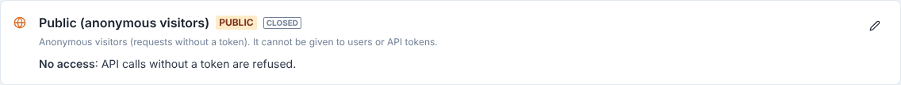

1. Click the pencil on the **Public** card.
2. Under **Permissions**, check **Read** for each type visitors may read. There is no
   "all types" row: each type is opened one by one, so a type you create later stays private
   until you open it here.
3. Click **Save changes**.

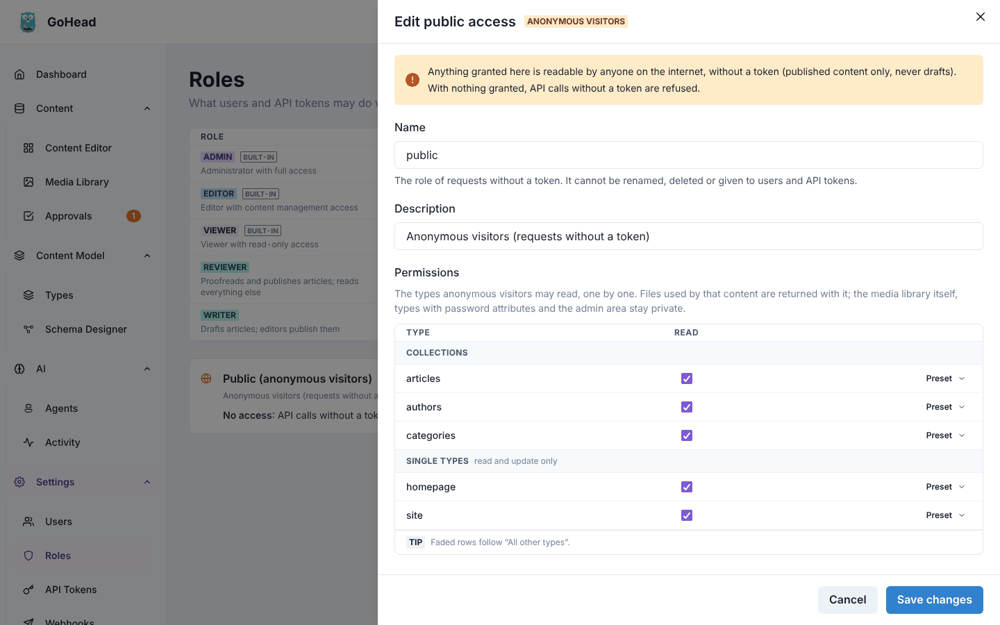

The card now says which types anyone can read:

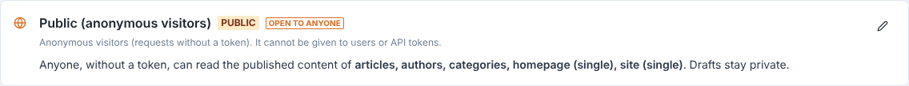

!!! warning
    Anything granted here is readable by anyone on the internet. Images and files used by
    public content are returned with it, but the media library itself, types with password
    fields and the admin area stay private. For content only your own servers should read,
    keep public access closed and use an [API token](api-tokens.md) instead.

### Check what visitors see

Open a **private browser window** (so you are not signed in) and go to your API's address
followed by `/api/collections/<type>`, for example
`https://cms.example.com/api/collections/categories`. You should see the published entries
as JSON:

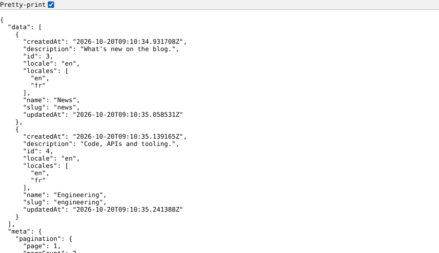

A type that is not public answers `{"error": {"message": "Authentication required", …}}`,
and so do drafts (`?status=draft`).

For every rule (relations, rate limits, GraphQL), see
[Public access](../guides/users-and-roles.md#public-access).
