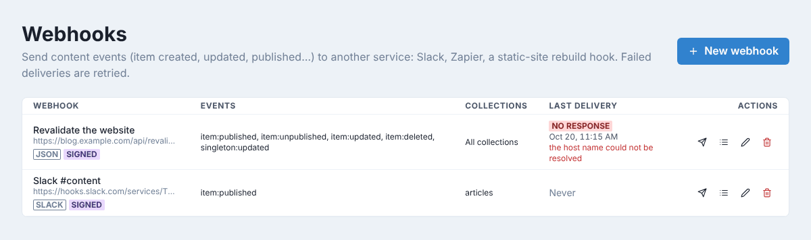
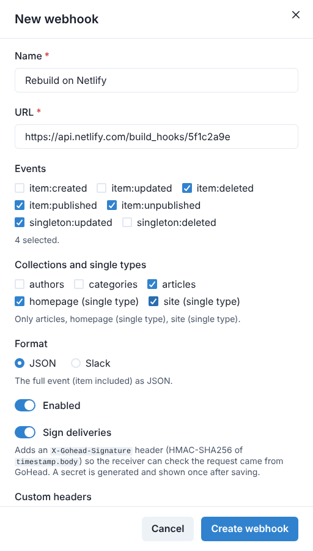
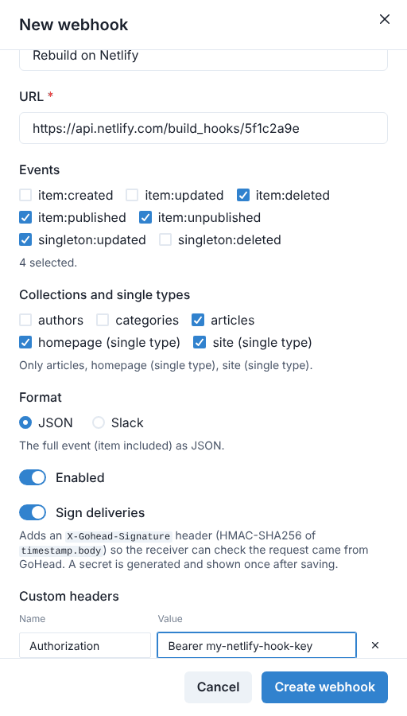
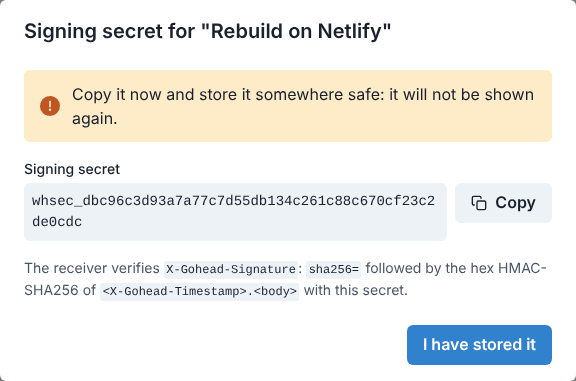
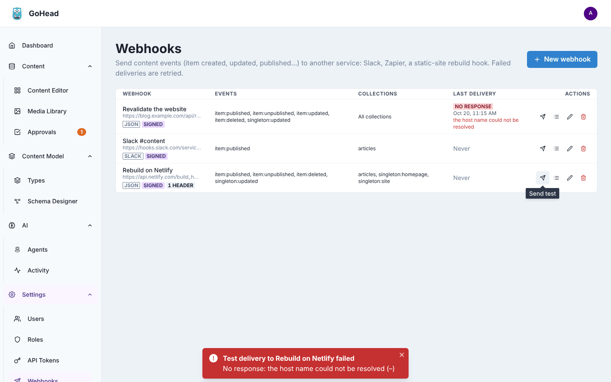
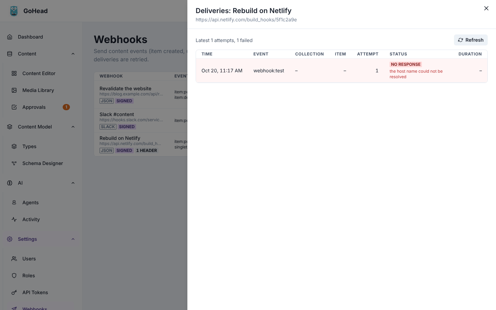

# Webhooks

A webhook tells another service when content changes: GoHead sends an HTTP request to a URL
you choose each time an entry is created, updated, published, deleted… Use it to rebuild or
refresh a website, post a message in Slack, or start a Zapier, Make or n8n workflow. Only
admins manage webhooks, under **Settings → Webhooks**.

The page lists each webhook with its URL, its format (**json** or **slack**), whether it is
**signed**, the events and collections it listens to, and how its last delivery went.

## Create a webhook

1. Click **New webhook**.
2. Give it a **Name** and the **URL** to call: an absolute `https://` address, given by the
   service that receives the events (a deploy hook, a Slack incoming webhook…).
3. Under **Events**, check the events to send. With none checked, every event is sent.
    - `item:created`, `item:updated`, `item:deleted`: an entry of a collection changed,
      drafts included.
    - `item:published`, `item:unpublished`: what readers see changed. Pick these to rebuild
      a site only when it matters.
    - `singleton:updated`, `singleton:deleted`: a single type (a home page, the site
      settings) was changed or cleared.
4. Under **Collections and single types**, check the types to watch. With none checked,
   events from every collection and single type are sent.

    

5. Pick the **Format**:
    - **JSON**: the full event, with the entry, for your own code or an automation tool.
    - **Slack**: a short text message that Slack (and Slack-compatible services such as
      Mattermost) can post as is.
6. Leave **Enabled** on, and **Sign deliveries** on unless the receiver cannot check
   signatures (see below).
7. If the receiver expects a header, such as a key, click **Add headers**, then
   **Add header**, and type its name and value.
8. Click **Create webhook**.

!!! note
    Header values are stored but never shown again. When you edit the webhook, click
    **Replace headers** and type them all again to change them.

## Keep the signing secret

With **Sign deliveries** on, GoHead shows the webhook's **signing secret** once, after
saving. Copy it, give it to the receiver, then click **I have stored it**.

Each request then carries an `X-Gohead-Signature` header that the receiver uses, with the
secret, to check the request really comes from your GoHead. If the secret leaks, edit the
webhook and check **Generate a new secret (the old one stops working)**. How to verify a
signature: [Verify the signature](../guides/integrations.md#verify-the-signature).

## Send a test

Click the paper-plane icon (**Send test**) in the webhook's row. GoHead sends a
`webhook:test` event right away and tells you how it went: **Test delivered** with the HTTP
status, or **Test delivery failed** with the reason.

Here the URL's host does not exist. Other common reasons are a wrong URL, a missing header
the receiver requires, or a receiver on a private network, which GoHead refuses unless its
configuration allows it.

## Check the deliveries

Click the list icon (**Deliveries**) in the webhook's row to see its last 100 attempts: the
event, the entry, the attempt number, the HTTP status and how long it took. Failed attempts
are highlighted in red with their error. Click **Refresh** to load new ones.

A delivery that fails because of a network error, a timeout or a `5xx` answer is retried
automatically for several hours, each retry with a new attempt number. Other errors (`4xx`,
redirects) are not retried: fix the webhook, then send a test.

!!! warning
    Content events are sent by GoHead's background workers, which need Redis. If deliveries
    never appear while tests work, ask whoever runs GoHead to check the `dispatcher` and
    `worker` processes.

To change a webhook, click its pencil; to stop it for a while, turn **Enabled** off; to
remove it and its delivery log, click its bin. For the request format and every option, see
[Outbound webhooks](../guides/integrations.md#outbound-webhooks).
