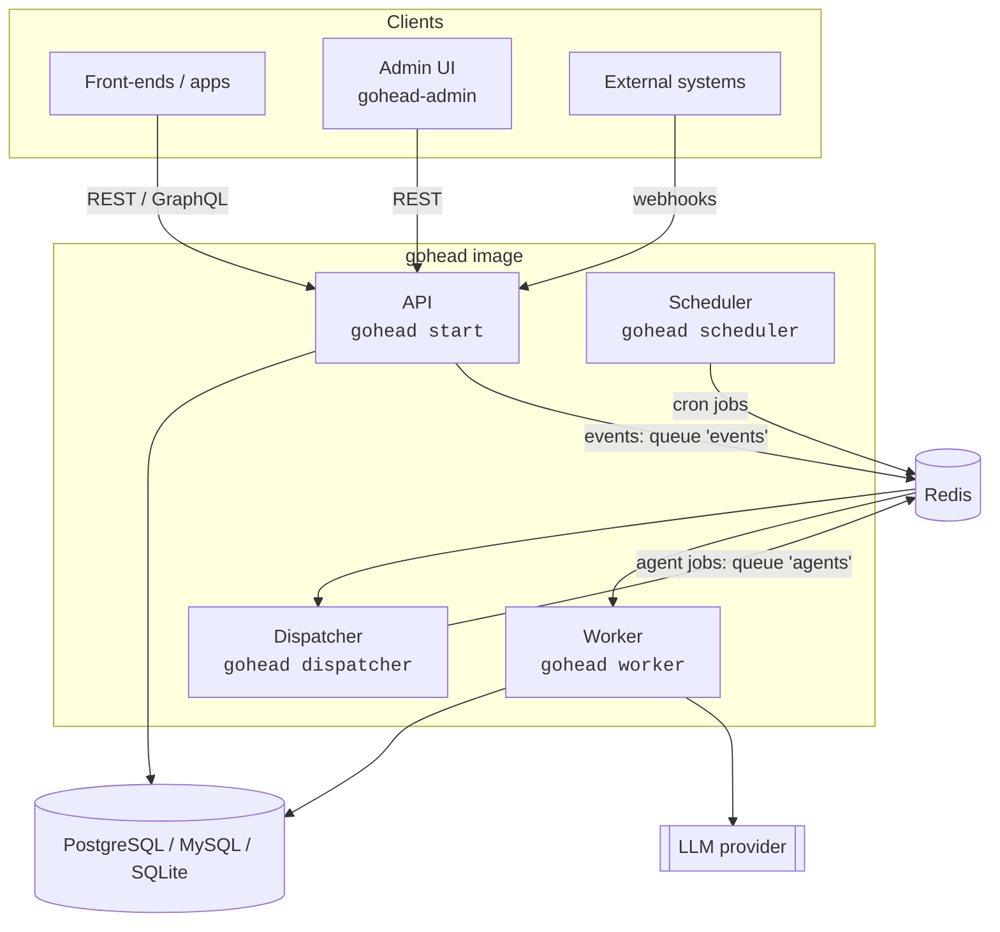

# Architecture

| Component | State | Scaling |
|-----------|-------|---------|
| API | stateless (tokens are JWTs) | horizontal, with Redis ([details](deployment.md#scaling)) |
| Dispatcher | stateless | horizontal |
| Worker | stateless, 10 concurrent jobs per process | horizontal |
| Scheduler | in-memory schedule | **one replica** |
| Database | all content, schema, users, agents, agent history | your database's HA |
| Redis | queues (events, agent jobs, webhook deliveries), schema-change broadcast, rate-limit counters | Redis HA / managed Redis |
| Media store | uploaded files (local directory or S3-compatible bucket) | your object store's HA |

## Request path

1. Gin middleware: logging, recovery, CORS, Prometheus metrics, OpenTelemetry, JWT auth,
   role check, response envelope.
2. Handlers validate input against the collection schema and write through the storage layer
   (GORM), inside transactions where several rows change.
3. After commit, the storage layer queues an event (in Redis, or in the `jobs` table with
   the database queue).

## Standalone

`gohead standalone` runs the four roles in one process and queues jobs in the database
(`queue.driver: database`), so the only dependency is the database, SQLite by default. The
queue interface (`pkg/queue`) has two drivers, Redis (asynq) and database; the dispatcher,
worker and scheduler code is the same with both. See
[Standalone and Raspberry Pi](standalone.md).

## Code map

| Path | Contents |
|------|----------|
| `main/`, `cmd/` | Entry point and the commands |
| `pkg/queue` | Job queue: Redis (asynq) and database drivers |
| `internal/webui` | Admin UI embedded in the binary (built by `make ui`) |
| `internal/api` | HTTP handlers and middleware |
| `internal/graphql` | Schema generation, resolvers, mutations |
| `internal/models` | Collections, attributes, items, users, validation |
| `internal/agent` | Dispatcher, worker runner, functions, triggers, job types |
| `pkg/storage` | Database access, queries, events |
| `pkg/auth` | JWT and role permissions |
| `pkg/llm` | Provider adapters (OpenAI, Anthropic, Ollama) |
| `pkg/config`, `pkg/database`, `pkg/migrations` | Configuration, connections, schema migration |
| `gui/` | Admin UI (React + Vite) |
| `deploy/` | Kubernetes manifests and Flux automation |
