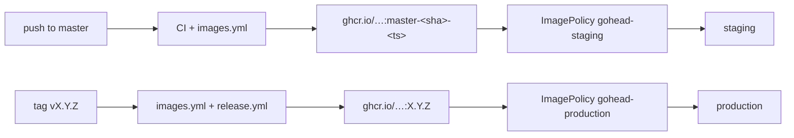

# Deployment

GoHead ships as two container images, both multi-arch (`amd64`, `arm64`) and signed:

| Image | Runs |
|-------|------|
| `ghcr.io/gohead-cms/gohead` | `start`, `worker`, `dispatcher`, `scheduler` (one image, four commands) |
| `ghcr.io/gohead-cms/gohead-admin` | the admin UI (nginx, port 8080) |

You need PostgreSQL (recommended) or MySQL, and Redis if you use agents.

## Checklist

- [ ] `GOHEAD_JWT_SECRET` set to a long random value, identical for every API replica
- [ ] `GOHEAD_DATABASE_URL` points to PostgreSQL/MySQL with TLS
- [ ] Redis reachable, with a password (`GOHEAD_REDIS_PASSWORD`)
- [ ] `GOHEAD_CORS_ALLOWED_ORIGINS` lists your front-ends
- [ ] TLS terminated in front of the API and the admin UI
- [ ] Admin account registered right after the first start
- [ ] `GOHEAD_TRUSTED_PROXIES` set to your ingress/load balancer addresses
- [ ] Exactly one `scheduler` replica
- [ ] Database backups scheduled

## Docker Compose (single host)

The repository's [`docker-compose.yml`](https://github.com/gohead-cms/gohead/blob/master/docker-compose.yml)
runs the whole stack. For a server, pin a version and put a reverse proxy with TLS in front:

```bash
cat > .env <<'ENV'
GOHEAD_VERSION=0.2.0
GOHEAD_JWT_SECRET=<openssl rand -hex 32>
GOHEAD_PUBLIC_API_URL=https://api.example.com
OPENAI_API_KEY=sk-...
ENV
docker compose pull && docker compose up -d
```

## Kubernetes with Flux

`deploy/` contains everything needed for a GitOps setup:

```text
deploy/
├── kubernetes/
│   ├── base/                     # API, worker, dispatcher, scheduler, admin UI, config
│   └── overlays/
│       ├── staging/              # follows master builds
│       └── production/           # follows releases
└── flux/image-automation.yaml    # ImageRepository / ImagePolicy / ImageUpdateAutomation
```

The base hardens the pods: non-root, no capabilities, read-only root filesystem (GoHead
processes),
seccomp `RuntimeDefault`, resource requests and limits, health probes on `/_health`.

### Secrets

Each overlay has an `ExternalSecret` that builds the `gohead-secrets` Secret from Azure Key
Vault through External Secrets Operator:

| Secret key | Vault entry (staging) |
|------------|-----------------------|
| `GOHEAD_DATABASE_URL` | `gohead-staging-database-url` |
| `GOHEAD_JWT_SECRET` | `gohead-staging-jwt-secret` |
| `GOHEAD_REDIS_PASSWORD` | `gohead-staging-redis-password` |
| `OPENAI_API_KEY` | `gohead-openai-api-key` |

Change `secretStoreRef.name` to your `ClusterSecretStore`. Not using ESO? Delete
`external-secret.yaml` from the overlay and create the Secret another way (Sealed Secrets,
SOPS).

### Wiring it into your fleet repository

1. Enable the image automation controllers:

    ```bash
    flux bootstrap github ... \
      --components-extra=image-reflector-controller,image-automation-controller
    ```

2. Copy `deploy/kubernetes` into the fleet repository (for example `apps/gohead/`) and point a
   Flux `Kustomization` at each overlay.
3. Apply `deploy/flux/image-automation.yaml`, adjusting `update.path` and the Git branch to your
   repository layout.
4. Set the public URL of the API in each overlay's admin patch, and add your Ingress or
   Gateway routes for `gohead-api` and `gohead-admin`.

### How releases flow



Flux commits the new tag into the overlay's `kustomization.yaml` (the
`# {"$imagepolicy": …}` markers) and reconciles. Rolling back means reverting that commit, or
pinning `newTag`.

## Scaling

- **Workers and dispatchers** scale horizontally; add worker replicas for agent throughput.
- **Scheduler:** one replica only (`strategy: Recreate` in the manifests).
- **API:** scales horizontally when every replica shares the same database, Redis and
  `GOHEAD_JWT_SECRET`. Collection changes are broadcast over Redis, so every replica rebuilds
  its GraphQL schema (missed messages are caught up within 30 s), and auth rate limits are
  counted across replicas. Set `GOHEAD_TRUSTED_PROXIES` to your ingress's IPs/CIDRs so limits
  apply per user rather than per ingress pod. Without Redis, keep one API replica.
- **SQLite** supports a single writer: use it only with one API replica and no separate
  workers on other hosts.

## Upgrades

Database migrations run automatically when `gohead start` boots. Upgrade the API first, then
the background processes. Read the [changelog](../reference/changelog.md) before upgrading
across minor versions.

## Backups

Everything durable is in the database: back it up with your usual tooling (`pg_dump`, managed
snapshots). Redis only holds queued jobs.
