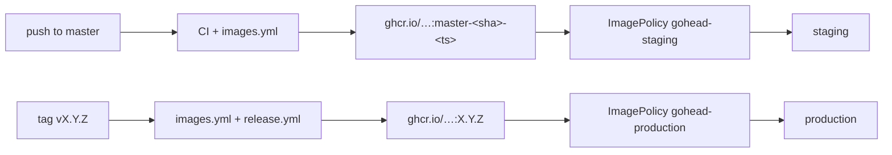

# Deployment

GoHead ships as two container images, both multi-arch (`amd64`, `arm64`) and signed:

| Image | Runs |
|-------|------|
| `ghcr.io/gohead-cms/gohead` | `start`, `worker`, `dispatcher`, `scheduler` (one image, four commands) |
| `ghcr.io/gohead-cms/gohead-admin` | the admin UI (nginx, port 8080) |

You need PostgreSQL (recommended) or MySQL, and Redis if you use agents or webhooks (or the
[database job queue](standalone.md#how-the-job-queue-works-without-redis) with a single API
process). For one machine, [standalone](standalone.md) is simpler. To run it in the cloud in
one click, see [Deploy to Render](render.md).

## Checklist

- [ ] `GOHEAD_JWT_SECRET` set to a long random value, identical for every API replica
- [ ] `GOHEAD_DATABASE_URL` points to PostgreSQL/MySQL with TLS
- [ ] Redis reachable, with a password (`GOHEAD_REDIS_PASSWORD`)
- [ ] `GOHEAD_CORS_ALLOWED_ORIGINS` lists your front-ends
- [ ] TLS terminated in front of the API and the admin UI
- [ ] Admin account registered right after the first start
- [ ] `GOHEAD_TRUSTED_PROXIES` set to your ingress/load balancer addresses
- [ ] Media stored in S3-compatible storage (`GOHEAD_MEDIA_DRIVER=s3`), or on a persistent
      volume at `GOHEAD_MEDIA_LOCAL_PATH` with a single API replica
- [ ] Exactly one `scheduler` replica
- [ ] Database backups scheduled

## Docker Compose (single host)

The repository's [`docker-compose.yml`](https://github.com/gohead-cms/gohead/blob/master/docker-compose.yml)
runs the whole stack. For a server, pin a version and put a reverse proxy with TLS in front:

```bash
cat > .env <<'ENV'
GOHEAD_VERSION=0.2.0
GOHEAD_JWT_SECRET=<openssl rand -hex 32>
GOHEAD_PUBLIC_API_URL=https://api.example.com
OPENAI_API_KEY=sk-...
ENV
docker compose pull && docker compose up -d
```

## Kubernetes with Helm

The chart deploys the API, the worker, the dispatcher, the scheduler, the admin UI and,
unless you point it at your own, a Redis. It is published with every release:

```bash
helm install gohead oci://ghcr.io/gohead-cms/charts/gohead --version 0.5.0 \
  --namespace gohead --create-namespace \
  --set database.url='postgres://gohead:<password>@db.example.internal:5432/gohead?sslmode=require'
```

Without an ingress, reach it with port-forwards, as the install notes explain:

```bash
kubectl -n gohead port-forward svc/gohead-api 8080:80     # API
kubectl -n gohead port-forward svc/gohead-admin 3000:80   # admin UI, calls localhost:8080
```

Register the first account right away: it becomes the admin.

For production, keep secrets out of values and set your hosts in a values file:

```yaml title="values-production.yaml"
existingSecret: gohead-secrets   # GOHEAD_DATABASE_URL, GOHEAD_JWT_SECRET, OPENAI_API_KEY…

config:
  GOHEAD_TRUSTED_PROXIES: 10.0.0.0/8
  GOHEAD_CORS_ALLOWED_ORIGINS: https://www.example.com,https://admin.example.com
  GOHEAD_MEDIA_DRIVER: s3
  GOHEAD_MEDIA_S3_REGION: eu-west-1
  GOHEAD_MEDIA_S3_BUCKET: example-gohead-media

api:
  replicas: 3
  ingress:
    enabled: true
    className: nginx
    hosts: [{ host: api.example.com, paths: [/] }]
    tls: [{ secretName: api-tls, hosts: [api.example.com] }]

admin:
  ingress:
    enabled: true
    className: nginx
    hosts: [{ host: admin.example.com, paths: [/] }]
    tls: [{ secretName: admin-tls, hosts: [admin.example.com] }]
  # apiUrl defaults to the first API ingress host (https://api.example.com)

redis:
  enabled: false
  address: my-redis.cache.amazonaws.com:6379   # password: GOHEAD_REDIS_PASSWORD in the Secret

serviceAccount:
  annotations:
    eks.amazonaws.com/role-arn: arn:aws:iam::123456789012:role/gohead-media   # S3 without keys
```

| Value | Default | |
|-------|---------|-|
| `database.url` / `existingSecret` | – | **Required.** PostgreSQL or MySQL; SQLite cannot be shared by the API and the workers |
| `jwtSecret` | generated | When empty, generated at install and kept by `helm upgrade`. With Argo CD, Flux or `helm template`, set it or use `existingSecret`: they render without the cluster and would generate a new one each time |
| `extraSecretEnv` | `{}` | More secret variables (provider API keys, S3 keys) when the chart creates the Secret |
| `config` | log level, mode | Any `GOHEAD_*` setting from the [configuration reference](../getting-started/configuration.md) |
| `image.tag`, `admin.image.tag` | chart `appVersion` | Pin or override the GoHead version |
| `api.replicas`, `api.autoscaling.*` | 2, off | HPA on CPU when enabled |
| `api.ingress.*`, `admin.ingress.*` | off | Standard `networking.k8s.io/v1` ingresses |
| `api.uploads.persistence.*` | off | Volume for local uploads (one API replica with `ReadWriteOnce`) |
| `api.podDisruptionBudget.*` | on, `minAvailable: 1` | Only created with 2+ replicas or autoscaling |
| `worker.*`, `dispatcher.*` | 1 replica each | Disable both if you don't use agents or webhooks |
| `scheduler.enabled` | on | Always a single replica, recreated on upgrade |
| `redis.enabled` / `redis.address` | bundled, no persistence | Use a managed Redis in production |
| `serviceMonitor.enabled` | off | Prometheus Operator scrape of `/_metrics` |

Pods run as non-root without capabilities (GoHead and Redis also with a read-only root
filesystem; the admin UI's nginx writes its configuration at startup), and roll
automatically when the configuration or the Secret the chart manages changes. The API's
`/_metrics` endpoint is not authenticated: block it at your ingress if the API is public. `helm test`
checks that the API answers. See
[`charts/gohead/values.yaml`](https://github.com/gohead-cms/gohead/blob/master/charts/gohead/values.yaml)
for every option.

## Kubernetes with Flux

`deploy/` contains everything needed for a GitOps setup:

```text
deploy/
├── kubernetes/
│   ├── base/                     # API, worker, dispatcher, scheduler, admin UI, config
│   └── overlays/
│       ├── staging/              # follows master builds
│       └── production/           # follows releases
└── flux/image-automation.yaml    # ImageRepository / ImagePolicy / ImageUpdateAutomation
```

The base hardens the pods: non-root, no capabilities, read-only root filesystem (GoHead
processes),
seccomp `RuntimeDefault`, resource requests and limits, health probes on `/_health`.

### Secrets

Each overlay has an `ExternalSecret` that builds the `gohead-secrets` Secret from Azure Key
Vault through External Secrets Operator:

| Secret key | Vault entry (staging) |
|------------|-----------------------|
| `GOHEAD_DATABASE_URL` | `gohead-staging-database-url` |
| `GOHEAD_JWT_SECRET` | `gohead-staging-jwt-secret` |
| `GOHEAD_REDIS_PASSWORD` | `gohead-staging-redis-password` |
| `OPENAI_API_KEY` | `gohead-openai-api-key` |

Change `secretStoreRef.name` to your `ClusterSecretStore`. Not using ESO? Delete
`external-secret.yaml` from the overlay and create the Secret another way (Sealed Secrets,
SOPS).

### Wiring it into your fleet repository

1. Enable the image automation controllers:

    ```bash
    flux bootstrap github ... \
      --components-extra=image-reflector-controller,image-automation-controller
    ```

2. Copy `deploy/kubernetes` into the fleet repository (for example `apps/gohead/`) and point a
   Flux `Kustomization` at each overlay.
3. Apply `deploy/flux/image-automation.yaml`, adjusting `update.path` and the Git branch to your
   repository layout.
4. Set the public URL of the API in each overlay's admin patch, and add your Ingress or
   Gateway routes for `gohead-api` and `gohead-admin`.

### How releases flow



Flux commits the new tag into the overlay's `kustomization.yaml` (the
`# {"$imagepolicy": …}` markers) and reconciles. Rolling back means reverting that commit, or
pinning `newTag`.

## Scaling

- **Workers and dispatchers** scale horizontally; add worker replicas for agent throughput.
- **Scheduler:** one replica only (`strategy: Recreate` in the manifests).
- **API:** scales horizontally when every replica shares the same database, Redis and
  `GOHEAD_JWT_SECRET`. Collection changes are broadcast over Redis, so every replica rebuilds
  its GraphQL schema (missed messages are caught up within 30 s), and auth rate limits are
  counted across replicas. Store media in S3 so every replica serves the same files. Set `GOHEAD_TRUSTED_PROXIES` to your ingress's IPs/CIDRs so limits
  apply per user rather than per ingress pod. Without Redis, keep one API replica.
- **SQLite** supports a single writer: use it only with one API replica and no separate
  workers on other hosts.

## Upgrades

Database migrations run automatically when `gohead start` boots. Upgrade the API first, then
the background processes. Read the [changelog](../reference/changelog.md) before upgrading
across minor versions.

## Backups

Everything durable is in the database: back it up with your usual tooling (`pg_dump`, managed
snapshots). Redis only holds queued jobs.
